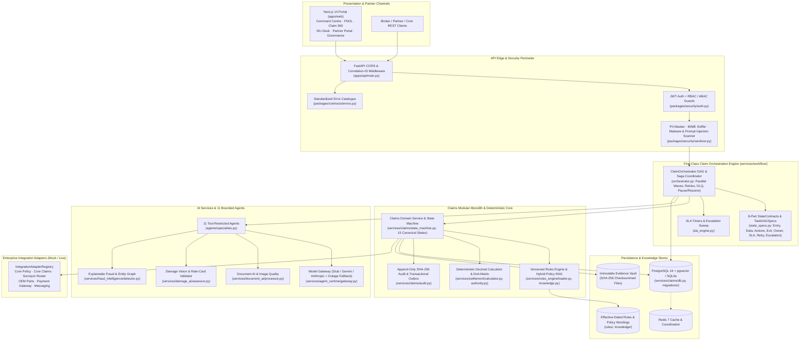
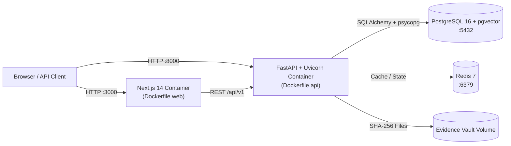

# System Design & Architecture — MotorClaim AI Intelligence Solution

> **Scope:** Enterprise Agentic AI Motor-Insurance Claims Intelligence, Automation & Decision-Support Platform (India-first, extensible multi-jurisdiction design).

---

## 1. Architectural Vision & Core Invariants

Motor-insurance claims sit at the intersection of **strict statutory regulation** (IRDAI Master Circular 2024, DPDP Act/Rules, Motor Vehicles Act), **high financial sensitivity** (depreciation, deductibles, salvage, IDV caps, GST/payouts), and **multi-party operational complexity** (policyholders, call-centre executives, adjusters, IIISLA surveyors, repair garages, SIU fraud analysts, legal/TP specialists, finance approvers, and auditors).

Accordingly, the system enforces five non-negotiable architectural invariants:

1. **Orchestrator-First, Agent-Assisted:** The `ClaimOrchestrator` (`services/workflow/orchestrator.py`), 8-part state contracts (`services/workflow/state_specs.py`), relational domain database (`services/claims/models.py`), and explicit state machine (`services/claims/state_machine.py`) own all claim progression, DAG scheduling, parallel execution, retries, DLQ, compensation, SLA timers, pause/resume/recovery, and transactional outbox events. Agents never independently decide workflow state or overall progression; `ControlledActionExecutor` enforces strict tool/policy boundaries.
2. **Deterministic Financial & Regulatory Core:** All money math (`Decimal` with `ROUND_HALF_UP`), depreciation schedules, deductibles, Constructive Total Loss (`>= 75%` IDV), mandatory survey thresholds (`>= ₹50,000`), and Delegation-of-Authority (DoA) checks execute in deterministic Python services backed by effective-dated JSON rules (`rules/india/`, `rules/common/`).
3. **Least-Privilege, Tool-Permissioned Agents:** Every agent inherits from `BoundedAgent` (`services/agent_runtime/base.py`), declares an explicit `allowed_tools` set, receives PII-masked `minimised_facts`, and returns schema-validated `AgentInvocationResponse` objects (`packages/contracts/agents.py`).
4. **Server-Side Tenant & ABAC Isolation:** Every endpoint validates JWT claims and enforces `enforce_claim_abac`, `enforce_siu_access`, and `enforce_tp_medical_access` (`packages/security/auth.py`) at the API/query layer—never via UI hiding.
5. **Graceful Degradation & Replaceable Adapters:** LLM/OCR/Vision providers sit behind `ModelGateway` (`services/agent_runtime/gateway.py`), and external systems sit behind `IntegrationAdapterRegistry` (`services/integrations/adapters.py`). If AI models go offline, FNOL intake and deterministic human workflows continue uninterrupted.

---

## 2. High-Level System Design

---

## 3. Layered Responsibility Matrix

| Layer | Directory / Module | Key Responsibilities | Non-Responsibilities (Hard Boundaries) |
|---|---|---|---|
| **Frontend UI** | `apps/web/src/` | Role-aware workspaces, accessible UI (`WCAG 2.2 AA` contrast/labels), explicit badges distinguishing Verified Facts vs Extracted vs AI Assistive vs Human Decisions, Orchestration Control & 8-Part State Inspector | Never computes authoritative payouts or enforces security alone |
| **API Gateway / Edge** | `apps/api/` | Versioned `/api/v1` REST contracts, OpenAPI docs, `X-Correlation-ID` propagation, idempotency key headers, standardized error responses | Never embeds business math or SQL in route handlers where a domain service owns it |
| **Security & Privacy** | `packages/security/` | JWT issuance/validation, 11-role RBAC + tenant/partner ABAC, SIU/TP medical compartmentalization, PII masking in logs/prompts, upload magic-byte & EICAR malware checks, prompt-injection sanitization | Never logs raw PAN, Aadhaar, phone numbers, or bank account numbers |
| **Claim Orchestration Engine** | `services/workflow/` | First-class DAG `ClaimOrchestrator`, exclusive ownership of state transitions, 8-property `StateContractSpec` (`state_specs.py`), Post-FNOL `ThreadPoolExecutor` parallel waves, conditional/sequential gating, exponential-backoff retries, DLQ, Saga compensation, pause/resume/recovery, duplicate-event dedup, SLA sweeps | Never delegates workflow control or state mutations back to individual agents |
| **Domain & State Machine** | `services/claims/` | 31 relational entities (incl. `OrchestrationTask`, `OrchestrationEventLog`, `DeadLetterRecord`, `CompensationLog`), explicit state transition graph (`ALLOWED_TRANSITIONS` + 15 canonical states), append-only SHA-256 audit events, transactional outbox | Never deletes audit history or allows unvalidated state jumps |
| **Rules & Knowledge** | `services/rules_engine/` | Loads effective-dated JSON rules, syncs `RuleVersion` rows, hybrid TF-IDF + cosine retrieval over synthetic policy wordings with clause/page citations | Never hard-codes regulatory thresholds inside LLM prompts |
| **Settlement & Authority** | `services/settlement/` | `Decimal` line-by-line depreciation, Zero Dep & Consumables waivers, excess, CTL evaluation, DoA maker-checker enforcement | Never allows same-user maker/checker or bulk approvals |
| **Bounded Agents** | `agents/` + `services/agent_runtime/` | 11 specialised agents with least-privilege tool allowlists (`mutate_claim_state_directly` explicitly prohibited), confidence bands, limitations, and outage fallback | Never mutates claim states or DB tables directly, repudiates claims, or releases payments |

---

## 4. Deployment & Runtime Topology

### 4.1 Local & Containerized Topology (`docker-compose.yml`)

### 4.2 Production Target Topology (Cloud-Neutral)
- **Stateless API & Web Pods:** Horizontally scalable behind WAF / API Gateway with TLS termination and OIDC/SAML SSO.
- **Database & Vector Store:** Managed PostgreSQL with encrypted storage, automated point-in-time recovery (RPO <= 15 min), and read replicas for BI/analytics.
- **Object Storage:** S3-compatible immutable bucket with KMS encryption, versioning, and legal-hold object locks for `Evidence` binaries.
- **Private AI Endpoints:** Private VPC/peered Gemini or Anthropic endpoints with zero-data-retention / no-training contractual guarantees and circuit-breaker fallback.

---

## 5. Key Architecture Decision Records (ADRs)

| ADR | Decision | Rationale |
|---|---|---|
| **ADR-001** | **Modular Monolith first, clean service boundaries** | Avoids premature microservice network overhead while preserving strict package boundaries (`services/*`, `agents/*`, `packages/*`) for future extraction. |
| **ADR-002** | **Python `Decimal` for all monetary & percentage rules** | Prevents IEEE-754 floating-point rounding drift in depreciation, excess, CTL, and GST/payout ledger entries. |
| **ADR-003** | **Effective-dated JSON rules + DB `RuleVersion` registry** | Regulatory parameters (e.g., IRDAI ₹50,000 threshold, 24h/15d/7d/14d SLAs) can be simulated, compliance-approved, published, and rolled back without code or prompt rewrites. |
| **ADR-004** | **Alert-only Fraud Intelligence + Role Isolation** | Ensures IRDAI Fraud Monitoring Framework due process: alerts carry benign explanations and never automatically reject claims or freeze payouts. |
| **ADR-005** | **SQLAlchemy dual-target (PostgreSQL in Docker, SQLite for zero-dep local/CI)** | Enables sub-second deterministic pytest suites and effortless local onboarding while maintaining full Alembic migrations (`migrations/versions/`) for PostgreSQL. |
