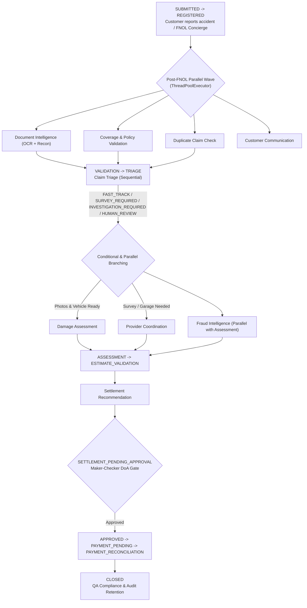

# Claims Lifecycle & State Machine

## 1. Eight Autonomous Claims Operations
`FNOL` -> `Validation` -> `Triage` -> `Assessment` -> `Investigation` -> `Settlement` -> `Payment` -> `Closure`

Every operational step is scheduled and transitioned exclusively by `ClaimOrchestrator` (`services/workflow/orchestrator.py`), emitting structured evidence, an agent/service `published_result`, controlled actions executed (`ClaimTask`, inspections, garage notices, approval requests, Finance-gated payouts — while direct agent status mutation is policy-blocked), a `DecisionRecord` (`reason_codes`, `policy_rule_refs`, `evidence`, `confidence`, `routing_outcome`, `explanation`), effective-dated business rules applied, explicit rework/retry/DLQ/compensation/pause-resume recovery hooks, and deterministic state exit evaluation.

## 2. Target Motor Claim Lifecycle & Orchestrator DAG Chain



## 3. Canonical & Legacy Claim States (`services/claims/state_machine.py`, `services/workflow/state_specs.py`)
`ClaimOrchestrator` exclusively owns all transitions (`ControlledActionExecutor.update_claim_status` blocks direct agent mutations with `blocked_policy`).

### Canonical Workflow Model (15 States, each backed by an 8-part `StateContractSpec`)
```
SUBMITTED
  -> REGISTERED
  -> VALIDATION
  -> TRIAGE
       ├── FAST_TRACK
       ├── SURVEY_REQUIRED
       ├── INVESTIGATION_REQUIRED
       └── HUMAN_REVIEW
  -> ASSESSMENT
  -> ESTIMATE_VALIDATION
  -> SETTLEMENT_PENDING_APPROVAL
  -> APPROVED
  -> PAYMENT_PENDING
  -> PAYMENT_RECONCILIATION
  -> CLOSED
```

Every canonical state in `WORKFLOW_STATE_SPECS` defines 8 explicit properties:
1. Entry conditions (`entry_conditions` / `evaluate_state_entry_conditions`)
2. Required data (`required_data`)
3. Allowed actions (`allowed_actions`)
4. Exit conditions (`exit_conditions` / `evaluate_state_exit_conditions`)
5. Responsible agent/service (`responsible_owner`)
6. SLA (`SLASpec`: warning, target, escalation targets)
7. Retry strategy (`RetryStrategySpec`: max retries, exponential backoff, jitter, timeout)
8. Human escalation criteria (`human_escalation_criteria`)

Legacy states (`INTIMATED`, `EVIDENCE_PENDING`, `COVERAGE_CHECKED`, `TRIAGED`, `SURVEY_ASSIGNED`, `AI_ASSESSMENT`, `ESTIMATE_REVIEW`, `SETTLEMENT_RECOMMENDED`, `APPROVAL_PENDING`, `PAYMENT_INITIATED`, `REPAIR_IN_PROGRESS`, `CLARIFICATION_REQUESTED`, `DECLINED_PARTIAL`, `REOPENED`) map deterministically via `LEGACY_TO_CANONICAL_STATE` / `to_canonical_state()` for backward compatibility.

## 4. Risk-Based Operational Paths (`IN-RISK-PROCESSING-2026`, `services/workflow/risk_engine.py`)
Every motor claim is classified into an explainable risk tier that recalculates automatically whenever new evidence, fact corrections, estimates, survey reports, fraud alerts, or grievances arrive (`LOW` claims can dynamically escalate to `HIGH` later):

1. **LOW RISK — Fast-track claims (`fast_track`):** Straight-through assisted processing to minimize human touchpoints. Requires minor damage, complete documents, valid policy, low estimate (`< ₹50,000`), and zero material anomalies. Eligible for automated processing & predefined auto-approval limit (`<= ₹25,000`; `₹25,000.01–₹49,999.99` L1 fast-track), bypassing physical survey dispatch.
2. **MEDIUM RISK — Standard claims (`standard`):** AI-assisted claims handling to reduce handler effort and waiting time. Handles damage requiring inspection, estimate discrepancies, missing documents, coverage clarification, and repair coordination.
3. **HIGH RISK — Complex / investigation claims (`complex_investigation`):** Specialist and human-led handling for injury or third-party liability (including multi-vehicle collisions), suspected fraud, significant loss (`>= ₹2,50,000`, CTL `>= 75%` IDV, fire/flood/theft, airbags), conflicting evidence, EV battery damage, or legal/coverage disputes. Automatically enables evidence preservation (`Evidence.legal_hold = true`), blocks L1 handler approval (`high_risk_complex`), and enforces `fraud_score_never_auto_rejects = true` (advisory `fraud_signal_score` itself never rejects a claim).

## 5. Pathway Controls
- **Incomplete Intimation:** Always accepted (`REGISTERED` / `EVIDENCE_PENDING`) with structured document checklist; never auto-rejected (`IN-IRDAI-MC-2024`).
- **Mandatory Survey:** Triggered deterministically when `estimated_loss_inr >= 50000.00` or for `theft`, `fire`, `flood`, `total_loss`, `injury_or_fatality`, or `ev_battery_impacted`.
- **TP Injury / Fatality / Property Damage:** A claim of type `third_party` is **never** processed by the OD estimate -> settlement -> auto-approval path. It opens a dedicated TP case with its own lifecycle, queues and controls (see section 6). Medical/legal party records stay restricted to authorised TP/Legal roles.
- **EV High-Voltage:** Flagged with HV isolation alert and routed to `ev_specialist` queue & EV-certified network garage (`POL-WORDING-EV-2025`).
- **Graceful Degradation:** On `ModelOutageError`, `BoundedAgent.execute()` returns `status="needs_human"` with `fallback_mode="manual_workflow"`, keeping FNOL, deterministic `Decimal` settlement math, Maker-Checker DoA, and idempotent payment reconciliation operational.

## 6. Third-Party (TP) Liability Lifecycle (`IN-TP-LIABILITY-2026`, `services/workflow/tp_liability.py`)

Own Damage (OD) and Third-Party (TP) claims are different products, not two variations of one workflow.

| | Own Damage (OD) | Third-Party (TP) |
|---|---|---|
| Nature | First-party repair / replacement | Legal liability to someone who is not the insured |
| Amount | Deterministic arithmetic on an estimate (depreciation, deductible, salvage) | Depends on fault, evidence, medical opinion, tribunal practice and legal strategy |
| Lifecycle | `ClaimStatus` (15 canonical states) | `TPStage` (12 stages) on `TPClaimCase` |
| Automation | LOW-risk claims up to INR 25,000 may be straight-through | **None.** Every stage is a human gate |
| Queues | Evidence intake, survey, estimate, finance | `tp_intake` ... `tp_settlement_control`, `tp_payment_authorisation`, `tp_closure_review` |
| Approval | Maker-checker DoA matrix | Reserve discipline + dual-control tiers (`TP-L1` / `TP-L2` / `TP-L3-COMMITTEE`) |

### Stages and exit gates

`INTAKE` -> `EVIDENCE_AND_FACTS` -> `POLICE_FIR` -> `LIABILITY_INVESTIGATION` -> `LEGAL_DOCUMENTATION` -> `ADVOCATE_COORDINATION` -> `MEDICAL_REVIEW` -> `LEGAL_SPECIALIST_REVIEW` -> `SETTLEMENT_CONTROL` -> `SETTLEMENT_APPROVED` -> `PAYMENT_AUTHORISED` -> `CLOSED`

- Stages are skipped by rule, and the skip is recorded in `stage_history`: `POLICE_FIR` (property damage without police), `ADVOCATE_COORDINATION` (no litigation and not contested), `MEDICAL_REVIEW` (property damage).
- Stages `INTAKE` to `LEGAL_SPECIALIST_REVIEW` are advanced only by an explicit human `POST /tp/advance`, and only when the exit gate is clear (`409 HUMAN_REVIEW_REQUIRED` with a `blockers` list otherwise). Legal-owned stages (`LEGAL_DOCUMENTATION`, `ADVOCATE_COORDINATION`, `MEDICAL_REVIEW`, `LEGAL_SPECIALIST_REVIEW`) can be advanced only by Legal/TP.
- `SETTLEMENT_CONTROL` -> `SETTLEMENT_APPROVED` happens only when the last required approver approves; `PAYMENT_AUTHORISED` only when Finance releases payment; `CLOSED` only through a manager's closure review.

### Controls

- **Liability is a human decision.** Fault split, contributory negligence, policy defences and a reasoned rationale are recorded by an authorised person. Software output (`advisory`: document completeness, reserve band, late-FIR/late-intimation flags) is non-binding and cannot advance a stage.
- **Coverage is never auto-declined for a third party.** A lapsed policy or a missing policy match marks the case `flagged` so Legal can decide statutory liability and any pay-and-recover route.
- **Legal decision** (`negotiate_settlement`, `contest_liability`, `pay_and_recover`) constrains the settlement basis (`negotiated`, `tribunal_award`, `pay_and_recover`). `pay_and_recover` needs a recorded policy defence and, at closure, an opened recovery action against the insured.
- **Reserve** is required before any settlement proposal; a proposal above the reserve is refused until the reserve is raised with a basis. Reserves above INR 5,00,000, or on a fatality, need a Claims Manager or Legal/TP specialist.
- **Dual-control approval tiers:** `TP-L1` up to INR 5,00,000 (non-fatal): Claims Manager. `TP-L2` up to INR 15,00,000 (or a fatality up to that amount): Claims Manager and Legal/TP, as distinct users. `TP-L3-COMMITTEE` above INR 15,00,000: Claims Manager, Legal/TP and Admin (claims committee).
- **Separation of duties:** the legal reviewer cannot propose the settlement; the proposer cannot decide it; each approver is a distinct user; the finance releaser cannot be the proposer, an approver or the legal reviewer. Payment authorisation is idempotent and blocks a second payout (mock gateway in DEMO).
- **OD isolation:** `settlement-recommendations`, `approvals`, `payments`, `payments/agent-release` and `close` return `409 HUMAN_REVIEW_REQUIRED` for a TP claim. `SettlementRecommendationAgent` returns `NEEDS_HUMAN` with no actions, the orchestrator never materialises a settlement from an OD estimate for TP, and the risk engine never marks a TP claim straight-through eligible.
- **OD claim with third-party exposure:** `POST /claims/{id}/tp/exposures` creates a separate linked `third_party` claim and TP case; the OD claim stays on the OD lifecycle.
- **Restricted data:** injured/deceased party details and medical opinions are masked for roles outside `TP_LEGAL_ALLOWED_ROLES`.
- **Audit:** every TP action writes an `AuditEvent` (`TP_*`); key milestones emit outbox events.

All statutory references and limits in `rules/india/tp_liability_controls.json` are synthetic and require legal/compliance sign-off before production use.

## 7. Electric-Vehicle (EV) Claims Lifecycle (`IN-EV-CLAIMS-2026`, `services/workflow/ev_claims.py`)

An electric vehicle is not ordinary vehicle damage. Traction-battery, high-voltage and thermal hazards are invisible in photographs and can surface hours or days after an impact, so EV claims run on a dedicated lifecycle (`EVStage` on `EVClaimCase`) that opens at FNOL with an HV safety hold.

**Hard rule:** the system never infers that an EV is safe to operate from external photographs. `safe_to_operate` is always `not_determinable_from_photographs`, the lowest impact band is `not_excluded` (never "safe"), the damage-assessment AI emits `ev_safety_determination.photo_only_clearance_allowed = false`, and potential battery damage is routed to specialist inspection.

| | Ordinary vehicle damage | Electric vehicle |
|---|---|---|
| Evidence | Photographs and a garage estimate are usually enough | Physical EV-HV inspection and OEM diagnostics; photographs are never sufficient |
| Lifecycle | `ClaimStatus` (OD) | `EVStage` (11 stages) alongside the OD claim |
| Automation | LOW-risk claims up to INR 25,000 may be straight-through | **None.** Never fast-tracked; the risk engine adds `MEDIUM_EV_HV_SCREENING` and never marks an EV straight-through eligible |
| Settlement | OD engine, maker-checker | OD engine **after** EV technical sign-off |

### Stages and exit gates

`INTAKE_TRIAGE` -> `SAFE_RECOVERY_ISOLATION` -> `SPECIALIST_SURVEY` -> `OEM_DIAGNOSTICS` -> `BATTERY_DISPOSITION` -> `COST_BENCHMARKING` -> `TECHNICAL_SIGN_OFF` -> `SETTLEMENT_CLEARED` -> `REPAIR_RECERTIFICATION` -> `SALVAGE_DISPOSAL` -> `CLOSED`

- Each stage has its own queue (`ev_triage_intake`, `ev_safe_recovery`, `ev_specialist_survey`, `ev_oem_diagnostics`, `ev_battery_disposition`, `ev_cost_benchmark`, `ev_technical_signoff`, `ev_settlement_in_od_engine`, `ev_recertification`, `ev_salvage_disposal`), owner role, SLA and exit gate. A stage advances only by an explicit human action once the gate is clear (`409 HUMAN_REVIEW_REQUIRED` with `blockers` otherwise); software never advances a stage.
- **Risk classes** (monotonic, never downgraded): `battery_critical` (critical thermal/HV signal, two or more high signals, or the claim is flagged battery-impacted; thermal watch required), `hv_suspected` (any signal, or a collision, underbody, flood or fire peril) and `screening_only` (no signal, for example glass damage). `screening_only` skips `SAFE_RECOVERY_ISOLATION`, `SPECIALIST_SURVEY` and `BATTERY_DISPOSITION` (recorded in `stage_history`) but still needs OEM HV screening. `SALVAGE_DISPOSAL` applies only if the disposition removes the pack.

### Controls

- **Battery pack impact and thermal risk signals:** 19 declared signals (impact, HV, thermal, charging, water) give an impact score and band (`not_excluded`, `possible`, `probable`, `severe`). Signals are append-only. Unknown signals return `400`. A customer-declared "drivable" is recorded but never accepted.
- **Safety escalation:** thermal-critical signals raise an `emergency` (15 minute SLA, "call 112"), HV and charging faults an `urgent` escalation (60 minutes). A policyholder can raise one at any time. It must be acknowledged to leave `INTAKE_TRIAGE`, and resolved (evidence reference and thermal-stable confirmation, by someone other than the raiser) before later stages. A new escalation after technical sign-off revokes the clearance and rewinds the case.
- **Safe recovery:** flatbed or on-site isolation only (wheel-lift, dolly and driving are refused), by an EV-HV qualified provider, with HV isolation verified and a quarantine location with the minimum clearance.
- **Specialist surveyor:** physical inspection only (photo, video and customer-declared modes are rejected) by a surveyor with the `ev_hv` skill, the EV-capable flag and a verified, unexpired licence. Partner users can act only for their own organisation.
- **OEM diagnostics:** an OEM-authorised EV workshop records the 7 required tests (DTC, BMS cell delta, insulation, HV interlock, coolant pressure, pack leak/IP, state of health) with an OEM report reference. A reported pass that breaches the measured threshold is refused.
- **Battery repair vs replacement:** the advisory is non-binding. A human records the decision with an OEM engineer reference. A critical test failure bars `repair_in_place` and `no_battery_work`, a pack costing 40% or more of IDV triggers `total_loss_review`, and the inspecting surveyor cannot be the signing OEM engineer.
- **EV parts cost benchmarks:** 12 EV part bands and an HV labour band (15% tolerance, suspiciously-low flag). Flagged lines or high-value quotes need a claims manager review note.
- **Technical sign-off:** the only step that lifts the settlement hold; the user who recorded the battery disposition cannot sign it off.
- **OD isolation:** `settlement-recommendations`, `approvals`, `payments` and `payments/agent-release` return `409 HUMAN_REVIEW_REQUIRED` until sign-off, and `close` until the EV case is closed. `SettlementRecommendationAgent` returns `NEEDS_HUMAN` (`route_to_ev_workflow`), and the orchestrator does not materialise a settlement for an uncleared EV.
- **Recertification and release:** insulation, DTC, interlock, charge test, thermal scan, physical road test and an OEM certificate; battery-critical claims also need the thermal watch cleared by a manager with an OEM reference. The vehicle is released only after this.
- **Salvage and disposal:** serial-tracked chain `pack_removed` -> `quarantined` -> `handed_over` (registered recycler, dangerous-goods compliant transport) -> `disposal_certified`. Resale as a used part and retention by the insured are forbidden; closure needs the certificate reference.
- **Audit:** every EV action writes an `AuditEvent` (`EV_*`); key milestones emit outbox events.

All thresholds, bands, clearances and the Battery Waste Management Rules reference in `rules/india/ev_claims_controls.json` are synthetic and require OEM, EV safety-officer and compliance sign-off before production use.
