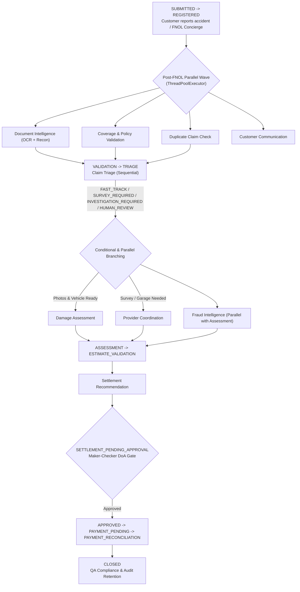

# Claims Lifecycle & State Machine

## 1. Eight Autonomous Claims Operations
`FNOL` -> `Validation` -> `Triage` -> `Assessment` -> `Investigation` -> `Settlement` -> `Payment` -> `Closure`

Every operational step is scheduled and transitioned exclusively by `ClaimOrchestrator` (`services/workflow/orchestrator.py`), emitting structured evidence, an agent/service `published_result`, controlled actions executed (`ClaimTask`, inspections, garage notices, approval requests, Finance-gated payouts — while direct agent status mutation is policy-blocked), a `DecisionRecord` (`reason_codes`, `policy_rule_refs`, `evidence`, `confidence`, `routing_outcome`, `explanation`), effective-dated business rules applied, explicit rework/retry/DLQ/compensation/pause-resume recovery hooks, and deterministic state exit evaluation.

## 2. Target Motor Claim Lifecycle & Orchestrator DAG Chain



## 3. Canonical & Legacy Claim States (`services/claims/state_machine.py`, `services/workflow/state_specs.py`)
`ClaimOrchestrator` exclusively owns all transitions (`ControlledActionExecutor.update_claim_status` blocks direct agent mutations with `blocked_policy`).

### Canonical Workflow Model (15 States, each backed by an 8-part `StateContractSpec`)
```
SUBMITTED
  -> REGISTERED
  -> VALIDATION
  -> TRIAGE
       ├── FAST_TRACK
       ├── SURVEY_REQUIRED
       ├── INVESTIGATION_REQUIRED
       └── HUMAN_REVIEW
  -> ASSESSMENT
  -> ESTIMATE_VALIDATION
  -> SETTLEMENT_PENDING_APPROVAL
  -> APPROVED
  -> PAYMENT_PENDING
  -> PAYMENT_RECONCILIATION
  -> CLOSED
```

Every canonical state in `WORKFLOW_STATE_SPECS` defines 8 explicit properties:
1. Entry conditions (`entry_conditions` / `evaluate_state_entry_conditions`)
2. Required data (`required_data`)
3. Allowed actions (`allowed_actions`)
4. Exit conditions (`exit_conditions` / `evaluate_state_exit_conditions`)
5. Responsible agent/service (`responsible_owner`)
6. SLA (`SLASpec`: warning, target, escalation targets)
7. Retry strategy (`RetryStrategySpec`: max retries, exponential backoff, jitter, timeout)
8. Human escalation criteria (`human_escalation_criteria`)

Legacy states (`INTIMATED`, `EVIDENCE_PENDING`, `COVERAGE_CHECKED`, `TRIAGED`, `SURVEY_ASSIGNED`, `AI_ASSESSMENT`, `ESTIMATE_REVIEW`, `SETTLEMENT_RECOMMENDED`, `APPROVAL_PENDING`, `PAYMENT_INITIATED`, `REPAIR_IN_PROGRESS`, `CLARIFICATION_REQUESTED`, `DECLINED_PARTIAL`, `REOPENED`) map deterministically via `LEGACY_TO_CANONICAL_STATE` / `to_canonical_state()` for backward compatibility.

## 4. Pathway Controls
- **Incomplete Intimation:** Always accepted (`REGISTERED` / `EVIDENCE_PENDING`) with structured document checklist; never auto-rejected (`IN-IRDAI-MC-2024`).
- **Mandatory Survey:** Triggered deterministically when `estimated_loss_inr >= 50000.00` or for `theft`, `fire`, `flood`, `total_loss`, `injury_or_fatality`, or `ev_battery_impacted`.
- **TP Injury / Fatality:** Routed to `legal_tp_specialist` queue; medical/legal party records restricted to authorised TP/Legal roles.
- **EV High-Voltage:** Flagged with HV isolation alert and routed to `ev_specialist` queue & EV-certified network garage (`POL-WORDING-EV-2025`).
- **Graceful Degradation:** On `ModelOutageError`, `BoundedAgent.execute()` returns `status="needs_human"` with `fallback_mode="manual_workflow"`, keeping FNOL, deterministic `Decimal` settlement math, Maker-Checker DoA, and idempotent payment reconciliation operational.
