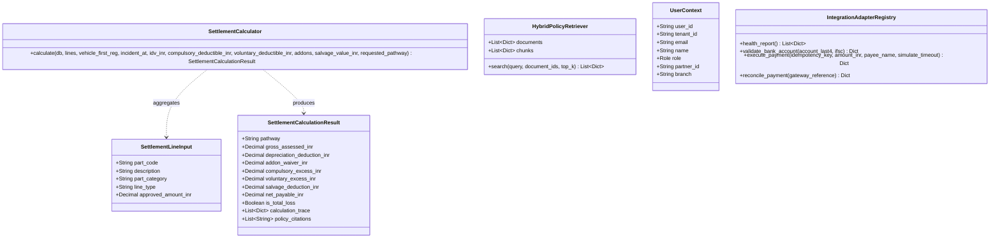

# Class Diagrams — MotorClaim AI Intelligence Solution

All class diagrams below reflect the actual implemented classes, fields, and relationships in the codebase.

---

## 1. Core Domain & Persistence Model (`services/claims/models.py`)

```mermaid
classDiagram
    class Tenant {
        +String id
        +String code
        +String name
        +String jurisdiction
        +Boolean is_synthetic_demo
    }

    class User {
        +String id
        +String tenant_id
        +String email
        +String name
        +String role
        +String partner_id
        +String branch
    }

    class Customer {
        +String id
        +String tenant_id
        +String name
        +String phone_token
        +String phone_masked
        +String email_masked
        +String preferred_language
    }

    class Vehicle {
        +String id
        +String registration_number
        +String vin_chassis
        +String make
        +String model
        +Integer year
        +String fuel_type
        +Boolean is_ev
        +DateTime first_registration_date
    }

    class Policy {
        +String id
        +String policy_number
        +String product_code
        +String uin
        +DateTime period_start
        +DateTime period_end
        +String status
        +Decimal idv_inr
        +Decimal compulsory_deductible_inr
        +Decimal voluntary_deductible_inr
        +JSON addons
    }

    class Provider {
        +String id
        +String provider_type
        +String name
        +String licence_or_contract_id
        +String licence_status
        +String city
        +Boolean ev_capable
        +Boolean is_network
        +Integer active_load
        +Decimal quality_score
    }

    class Claim {
        +String id
        +String claim_number
        +String idempotency_key
        +String claim_type
        +String peril_cause
        +String status
        +String severity_band
        +String queue_name
        +Decimal estimated_loss_inr
        +Boolean requires_mandatory_survey
        +Boolean injury_or_fatality
        +Boolean ev_battery_impacted
        +JSON coverage_factsheet
        +JSON triage_summary
    }

    class Evidence {
        +String id
        +String doc_type
        +String doc_status
        +String filename
        +String sha256
        +String malware_scan_status
        +Boolean prompt_injection_flagged
        +String image_angle
        +String image_quality_status
    }

    class ExtractedFact {
        +String id
        +String field_name
        +String extracted_value
        +String verified_value
        +Decimal confidence
        +String validation_status
    }

    class DamageAssessment {
        +String id
        +String component_name
        +String part_code
        +String damage_class
        +String observation_type
        +String recommended_action
        +Decimal confidence
        +String reviewer_outcome
    }

    class Estimate {
        +String id
        +Integer version
        +Boolean is_supplement
        +String status
        +Decimal total_claimed_inr
        +Decimal total_approved_inr
        +JSON anomalies
    }

    class EstimateLine {
        +String id
        +String part_code
        +String line_type
        +Integer quantity
        +Decimal unit_price_inr
        +Decimal rate_card_price_inr
        +Decimal approved_amount_inr
        +String variance_flag
        +String reviewer_status
    }

    class SurveyAssignment {
        +String id
        +String surveyor_id
        +String status
        +DateTime report_due_at
        +DateTime report_received_at
        +Boolean signed_by_surveyor
    }

    class FraudAlert {
        +String id
        +String indicator_code
        +String severity_band
        +Decimal confidence
        +String evidence_summary
        +String benign_explanation
        +String status
        +String disposition_reason
    }

    class Settlement {
        +String id
        +String pathway
        +Decimal gross_assessed_inr
        +Decimal depreciation_deduction_inr
        +Decimal addon_waiver_inr
        +Decimal compulsory_excess_inr
        +Decimal net_payable_inr
        +Boolean is_total_loss
        +JSON calculation_trace
        +String approval_status
    }

    class Approval {
        +String id
        +String action_type
        +Decimal amount_inr
        +String maker_user_id
        +String checker_user_id
        +String decision
        +String authority_rule_version
    }

    class Payment {
        +String id
        +String idempotency_key
        +String payee_type
        +String bank_account_masked
        +Boolean bank_verified
        +Decimal amount_inr
        +String status
        +String gateway_reference
    }

    class SLATimer {
        +String id
        +String stage
        +DateTime due_at
        +DateTime completed_at
        +String status
        +Decimal daily_penalty_inr
    }

    class AuditEvent {
        +String id
        +String actor_id
        +String actor_role
        +String action
        +String before_hash
        +String after_hash
        +String correlation_id
    }

    class OrchestrationTask {
        +String id
        +String claim_id
        +String task_key
        +String agent_name
        +String status
        +Integer attempt_count
        +Integer max_retries
        +String execution_mode
        +JSON depends_on
    }

    class OrchestrationEventLog {
        +String id
        +String claim_id
        +String event_key
        +String event_type
        +String status
        +JSON payload_json
    }

    class DeadLetterRecord {
        +String id
        +String claim_id
        +String task_key
        +String agent_name
        +String error_code
        +String status
        +Integer retry_count
    }

    class CompensationLog {
        +String id
        +String claim_id
        +String dlq_id
        +String trigger_reason
        +JSON executed_steps
        +String status
    }

    Tenant "1" --> "*" User
    Tenant "1" --> "*" Customer
    Tenant "1" --> "*" Policy
    Tenant "1" --> "*" Claim
    Customer "1" --> "*" Policy
    Vehicle "1" --> "*" Policy
    Policy "1" --> "*" Claim
    Claim "1" --> "*" Evidence
    Evidence "1" --> "*" ExtractedFact
    Claim "1" --> "*" DamageAssessment
    Claim "1" --> "*" Estimate
    Estimate "1" --> "*" EstimateLine
    Claim "1" --> "*" SurveyAssignment
    Provider "1" --> "*" SurveyAssignment
    Claim "1" --> "*" FraudAlert
    Claim "1" --> "*" Settlement
    Settlement "1" --> "*" Approval
    Settlement "1" --> "*" Payment
    Claim "1" --> "*" SLATimer
    Claim "1" --> "*" AuditEvent
    Claim "1" --> "*" OrchestrationTask
    Claim "1" --> "*" OrchestrationEventLog
    Claim "1" --> "*" DeadLetterRecord
    Claim "1" --> "*" CompensationLog
```

---

## 2. Bounded Agent Runtime & Specialised Agents (`services/agent_runtime/`, `agents/`, `packages/contracts/agents.py`)

```mermaid
classDiagram
    class AgentInvocationRequest {
        +String tenant_id
        +String claim_id
        +String correlation_id
        +String workflow_run_id
        +String actor_user_id
        +String actor_role
        +Dict rule_versions
        +Dict minimised_facts
        +List~String~ allowed_tools
    }

    class AgentInvocationResponse {
        +String agent_name
        +AgentStatus status
        +Dict result
        +Float confidence
        +ConfidenceBand confidence_band
        +List~EvidenceCitation~ evidence_refs
        +List~String~ missing_information
        +List~String~ contradictions
        +List~String~ limitations
        +String model_id
        +String prompt_version
        +String suggested_next_action
    }

    class ModelGateway {
        -_runtime_outage_override: bool
        +set_simulated_outage(enabled)
        +is_outage_active() bool
        +get_model_metadata() tuple
        +generate_structured_summary(task, facts) str
    }

    class BoundedAgent {
        <<abstract>>
        +String agent_name
        +String prompt_version
        +Set~String~ allowed_tools
        +register_tool(name, fn)
        +call_tool(name, request, kwargs)
        +execute(request) AgentInvocationResponse
        #_run(request, model_id, model_version)* AgentInvocationResponse
    }

    class FNOLConciergeAgent
    class DocumentIntelligenceAgent
    class CoverageIntelligenceAgent
    class ClaimTriageAgent
    class DamageAssessmentAgent
    class EstimateValidationAgent
    class FraudIntelligenceAgent
    class ProviderCoordinationAgent
    class SettlementRecommendationAgent
    class CustomerCommunicationAgent
    class QAComplianceAgent
    class PredictiveSLAAgent {
        +agent_name = sla_intelligence
        +execute(request, action_executor)
    }
    class SLARulesService {
        +resolve(metric, claim_type, at)
        +validate()
    }
    class SLAInstance
    class SLAPrediction
    class RecommendedAction

    BoundedAgent <|-- FNOLConciergeAgent
    BoundedAgent <|-- DocumentIntelligenceAgent
    BoundedAgent <|-- CoverageIntelligenceAgent
    BoundedAgent <|-- ClaimTriageAgent
    BoundedAgent <|-- DamageAssessmentAgent
    BoundedAgent <|-- EstimateValidationAgent
    BoundedAgent <|-- FraudIntelligenceAgent
    BoundedAgent <|-- ProviderCoordinationAgent
    BoundedAgent <|-- SettlementRecommendationAgent
    BoundedAgent <|-- CustomerCommunicationAgent
    BoundedAgent <|-- QAComplianceAgent
    BoundedAgent <|-- PredictiveSLAAgent
    PredictiveSLAAgent ..> SLARulesService : reads versioned rules
    PredictiveSLAAgent ..> SLAInstance : evaluates clocks
    PredictiveSLAAgent ..> SLAPrediction : predicts breaches
    PredictiveSLAAgent ..> RecommendedAction : plans, then authorise_action gates

    BoundedAgent ..> AgentInvocationRequest : consumes
    BoundedAgent ..> AgentInvocationResponse : returns
    BoundedAgent ..> ModelGateway : calls
```

---

## 3. Deterministic Settlement, Policy RAG & Security (`services/settlement/`, `services/rules_engine/`, `packages/security/`)

