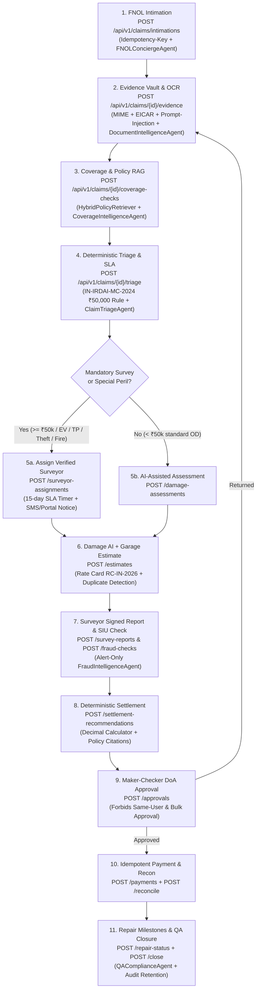
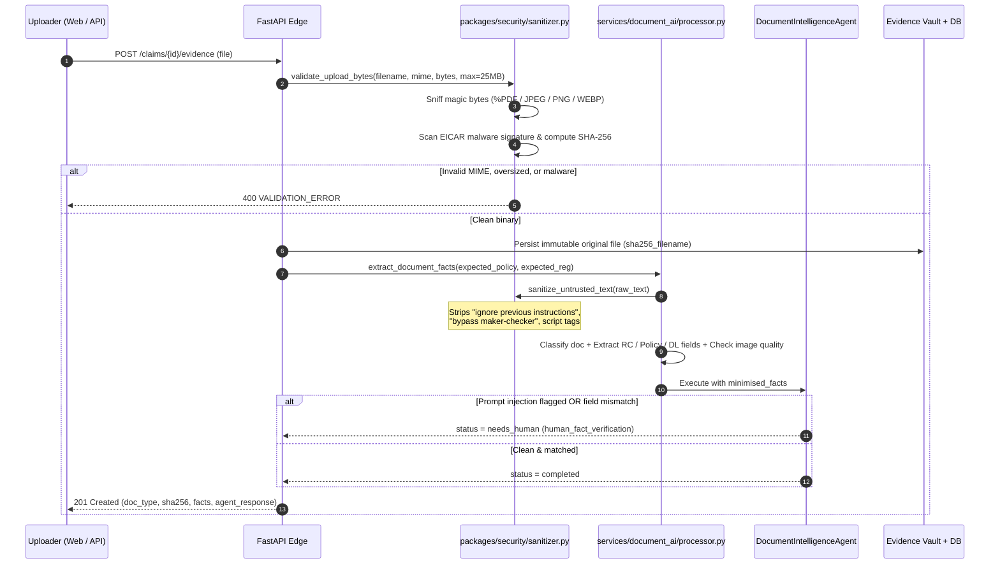
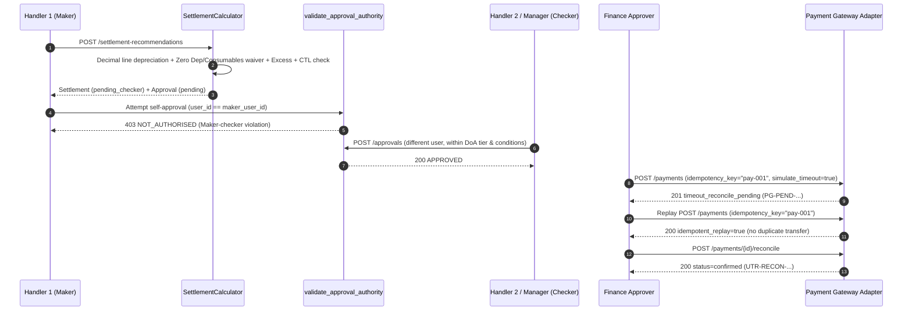

# Pipelines — MotorClaim AI Intelligence Solution

This document details every operational, AI, financial, and engineering pipeline in the platform.

---

## 1. End-to-End Claim Processing Pipeline

---

## 2. Document AI & Prompt-Injection Quarantine Pipeline

---

## 3. Hybrid Policy Retrieval (RAG) Pipeline

Implemented in `services/rules_engine/knowledge.py` (`HybridPolicyRetriever`):

1. **Corpus Indexing (`knowledge/synthetic_policy_samples/policies.json`):**
   - Loads `POL-WORDING-PC-2024` (Private Car Package) and `POL-WORDING-EV-2025` (EV Traction Battery Protect).
   - Splits into clause-level chunks retaining `document_id`, `uin`, `section`, `page`, and `clause_id`.
2. **IDF Pre-Computation:**
   - Tokenizes `title + section + text` and computes smoothed IDF weights across all policy clauses.
3. **Hybrid Scoring at Query Time:**
   - Computes TF-IDF vector cosine similarity (`weight = 0.65`) and exact keyword overlap ratio (`weight = 0.35`).
   - Returns top-`k` clauses with formatted provenance references (e.g., `POL-WORDING-PC-2024 ADDON-ZD-01 p.11`) attached to `CoverageIntelligenceAgent` and `SettlementCalculator` outputs.

---

## 4. Damage Vision & Rate-Card Estimate Validation Pipeline

Implemented in `services/damage_ai/assessor.py`:

1. **Image Coverage & Quality Gate:**
   - Checks uploaded images across the 6 required views (`front`, `rear`, `left`, `right`, `odometer`, `closeup`) and flags files marked `recapture_needed` (blurry, dark, or resolution `< 320x240`).
2. **Assistive Damage Observation Separation:**
   - Emits `visible_observed` observations (e.g., `PRT-FRT-BMP-01` Front Bumper, `PRT-HL-LED-RH` Headlamp) separately from `inferred_possible` items (e.g., `PRT-RAD-SUP-01` Radiator Core Support, `PRT-EV-BAT-TRAY` EV Underbody Tray) with explicit limitations.
3. **Estimate Line Validation (`validate_estimate_lines`):**
   - Compares each garage estimate line against `RC-IN-2026-DEMO-V1` (`knowledge/synthetic_policy_samples/rate_cards.json`):
     - **Duplicate Detection:** Repeated `(part_code, line_type)` triggers `DUPLICATE_LINE` anomaly and defaults recommended amount to `0.00` (without accusing fraud).
     - **Rate Variance:** Unit prices exceeding OEM rate card by `> 12.00%` trigger `RATE_VARIANCE` and cap recommended amount at OEM price.
     - **Quantity Anomaly:** `quantity > 2` on single-panel parts flags `QUANTITY_ANOMALY` for human review.
     - **Visible Damage Mismatch:** Parts absent from `DamageAssessment` are flagged `NOT_IN_VISIBLE_DAMAGE` for surveyor physical inspection.

---

## 5. Settlement, Maker-Checker & Idempotent Payment Pipeline

---

## 6. CI/CD & Quality Gate Pipeline (`.github/workflows/ci.yml`)

Triggered on every push to `main` / `feat/**` and on pull requests to `main`:

| Job | Steps Executed | Target |
|---|---|---|
| `backend-checks` | `pip install -e ".[dev]"` -> `ruff check` -> `mypy --explicit-package-bases` -> `pytest -v` (unit, integration, security, model_eval) | Python 3.12 |
| `frontend-checks` | `npm ci` -> `npm run typecheck` (`tsc --noEmit`) -> `npm run lint` (`next lint`) -> `npm run build` | Node 20 / Next.js 14 |
