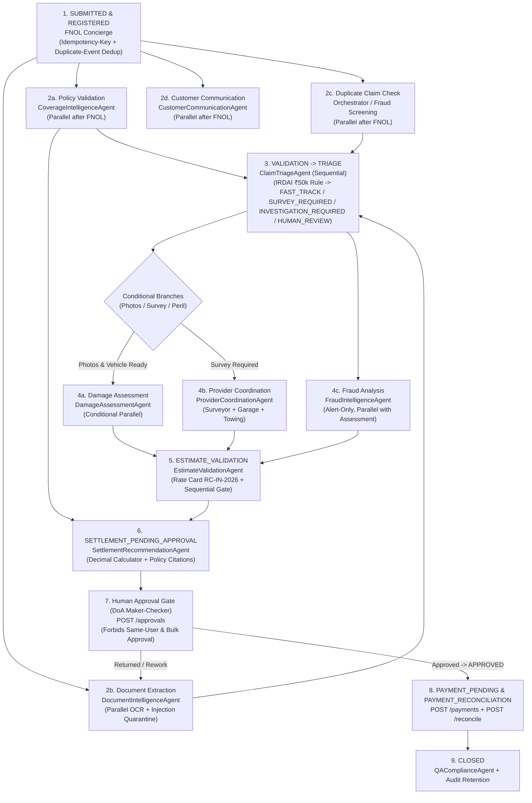
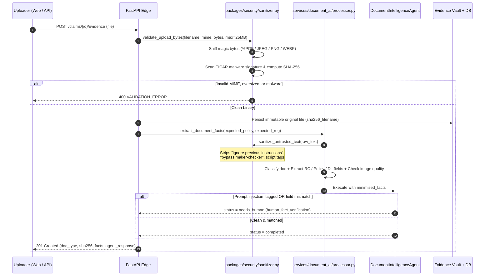
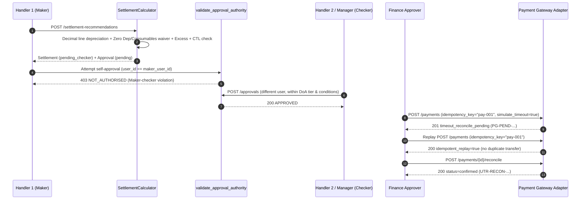

# Pipelines — MotorClaim AI Intelligence Solution

This document details every operational, AI, financial, and engineering pipeline in the platform.

---

## 1. End-to-End Orchestrator-Driven Claim Pipeline

`ClaimOrchestrator` (`services/workflow/orchestrator.py`) owns state progression, Post-FNOL parallel wave fan-out, conditional/parallel assessment gating, exponential-backoff retries, DLQ/Saga compensation, and approval/payment gates.

---

## 2. Document AI & Prompt-Injection Quarantine Pipeline

---

## 3. Hybrid Policy Retrieval (RAG) Pipeline

Implemented in `services/rules_engine/knowledge.py` (`HybridPolicyRetriever`):

1. **Corpus Indexing (`knowledge/synthetic_policy_samples/policies.json`):**
   - Loads `POL-WORDING-PC-2024` (Private Car Package) and `POL-WORDING-EV-2025` (EV Traction Battery Protect).
   - Splits into clause-level chunks retaining `document_id`, `uin`, `section`, `page`, and `clause_id`.
2. **IDF Pre-Computation:**
   - Tokenizes `title + section + text` and computes smoothed IDF weights across all policy clauses.
3. **Hybrid Scoring at Query Time:**
   - Computes TF-IDF vector cosine similarity (`weight = 0.65`) and exact keyword overlap ratio (`weight = 0.35`).
   - Returns top-`k` clauses with formatted provenance references (e.g., `POL-WORDING-PC-2024 ADDON-ZD-01 p.11`) attached to `CoverageIntelligenceAgent` and `SettlementCalculator` outputs.

---

## 4. Visual Damage Assessment (10-Step Pipeline) & Rate-Card Estimate Validation

Implemented in `services/damage_ai/assessor.py` & `agents/specialists.py` (`DamageAssessmentAgent`):

1. **10-Step Visual Damage Workflow:**
   1. Upload accident photos (`POST /api/v1/claims/{claim_id}/evidence`)
   2. Validate image quality (`good` / `poor` / `recapture` via resolution, luminance & contrast checks)
   3. Detect vehicle (`make`, `model`, `variant`) and localize visible damaged regions with bounding boxes
   4. Classify damaged components (`Bumper`, `Headlight`, `Door`, `Fender`, `Windshield`, `Bonnet`, `Rear Bumper`, `Tail Lamp`, `EV Battery Tray`, `Radiator Core Support`)
   5. Compare damage across photos (`corroborated`, `single_angle_only`, `conflicting`, `no_photo_coverage`)
   6. Identify inconsistencies (FNOL-vs-photo location mismatch, duplicate SHA-256 photo hash, vehicle identity mismatch)
   7. Generate `repair` / `replace` / `uncertain` recommendations governed by **per-component confidence** (high overall image quality never forces beyond-repair on an occluded/uncertain component)
   8. Estimate parts (OEM & OES), labour, and paint via `RC-IN-2026-DEMO-V1`
   9. Request additional photos where necessary (`request_documents`)
   10. Route uncertain cases (`repairability == "uncertain"`, `component_confidence < 0.72`, inconsistencies, `poor`/`recapture` frames, EV HV impact) to a human assessor (`NEEDS_HUMAN` + `ClaimTask`)
2. **Structured Output Fields:**
   - Emits `vehicle`, `damage_location`, `damaged_component`, `damage_severity`, `repairability`, `visible_damage`, `possible_hidden_damage`, `image_quality`, per-component `component_confidence` + `confidence_factors`, and bounding-box `evidence` refs.
3. **Estimate Line Validation (`validate_estimate_lines`):**
   - Compares each garage estimate line against `RC-IN-2026-DEMO-V1` (`knowledge/synthetic_policy_samples/rate_cards.json`):
     - **Duplicate Detection:** Repeated `(part_code, line_type)` triggers `DUPLICATE_LINE` anomaly and defaults recommended amount to `0.00` (without accusing fraud).
     - **Rate Variance:** Unit prices exceeding OEM rate card by `> 12.00%` trigger `RATE_VARIANCE` and cap recommended amount at OEM price.
     - **Quantity Anomaly:** `quantity > 2` on single-panel parts flags `QUANTITY_ANOMALY` for human review.
     - **Visible Damage Mismatch:** Parts absent from `DamageAssessment` are flagged `NOT_IN_VISIBLE_DAMAGE` for surveyor physical inspection.

---

## 5. Settlement, Maker-Checker & Idempotent Payment Pipeline

---

## 6. CI/CD & Quality Gate Pipeline (`.github/workflows/ci.yml`)

Triggered on every push to `main` / `feat/**` and on pull requests to `main`:

| Job | Steps Executed | Target |
|---|---|---|
| `backend-checks` | `pip install -e ".[dev]"` -> `ruff check` -> `mypy --explicit-package-bases` -> `pytest -v` (unit, integration, security, model_eval) | Python 3.12 |
| `frontend-checks` | `npm ci` -> `npm run typecheck` (`tsc --noEmit`) -> `npm run lint` (`next lint`) -> `npm run build` | Node 20 / Next.js 14 |

## 7. AI Release Gate Pipeline (`.github/workflows/ai-release-gate.yml`)

Triggered on pushes and pull requests that touch agents, the agent runtime, prompts, contracts, security helpers, rules or `evals/`:

| Step | What it does |
|---|---|
| `pytest tests/evals` | Framework tests, including mutation tests proving the gate blocks sabotaged metrics, suites and registries |
| `python -m evals.gate --json --markdown` | Runs all datasets and six safety suites; writes the verdict to the job summary; exits 1 when the release is blocked |
| Site snapshot check | Fails if `site/eval-report.js` is out of sync with the gate output |

Details: [ai-evaluation.md](ai-evaluation.md).
