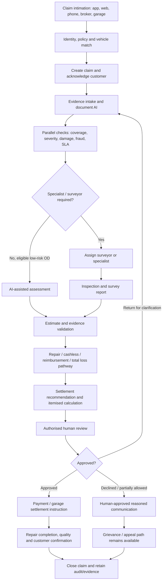
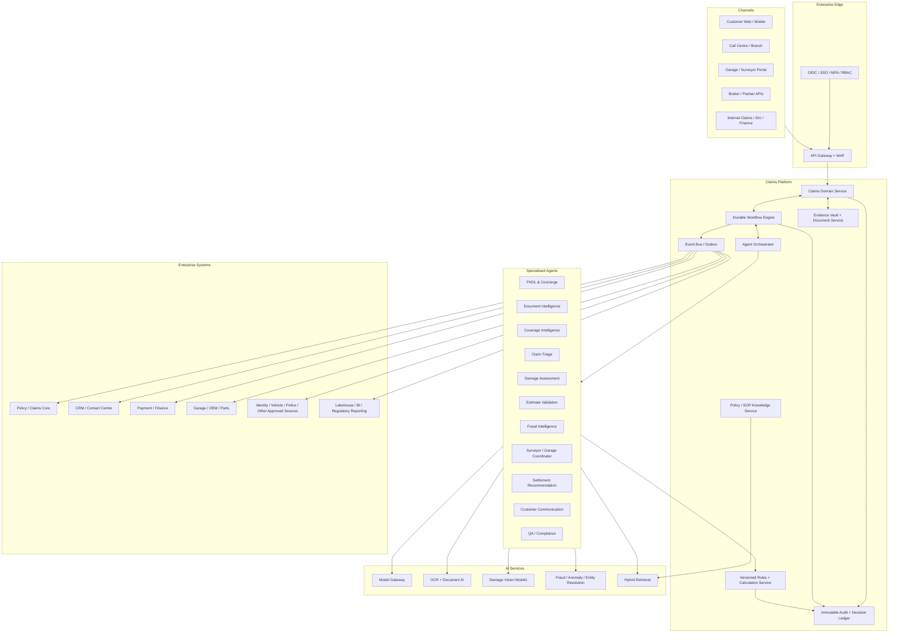

# Motor Claim AI Intelligence Solution — Enterprise Agentic AI Blueprint

> **Implementation plan for Claude / Gemini coding agents**  
> **Reference market:** India-first, with jurisdiction-specific configuration for later expansion  
> **Product type:** Enterprise motor-insurance claims intelligence, automation and decision-support platform  
> **Document status:** Build specification / source of truth  
> **Regulatory review date:** 26 November 2026

---

## 0. Instructions to the AI coding agent

Build this as a working, demonstrable enterprise application—not as a static landing page, a chatbot-only demo, or a collection of disconnected agent examples.

1. **Inspect the existing repository before coding.** Identify the current stack, conventions, working features, tests, deployment target and reusable components. Preserve working functionality unless an explicit migration is necessary.
2. If this is a greenfield repository, use the default stack in Section 13. Keep cloud, LLM, OCR, computer-vision and external-system dependencies behind replaceable adapters.
3. Implement the complete vertical slice first: FNOL → evidence ingestion → policy/coverage check → triage → damage/estimate assistance → fraud signals → human review → settlement recommendation → audit trail. Then expand the product.
4. Every major feature must have a functioning UI, backend/API, persistence, validation, tests and demo data. Do not mark a feature complete because a button or screen exists.
5. Use deterministic code for money calculations, policy rules, thresholds, eligibility and state transitions. Use LLMs for document interpretation, evidence summarisation, explanations and controlled tool orchestration—not as the source of truth for claim calculations or final decisions.
6. Agents must operate through typed, permissioned tools. No agent may directly update arbitrary database tables, approve/repudiate a claim, issue a payment, alter policy wording or bypass approval rules.
7. Any policy decision, fraud escalation, deduction, repudiation, liability determination, total-loss decision or payout must follow the configured human approval matrix. The system must explain what evidence supports a recommendation and what remains uncertain.
8. Never create fabricated claim data that could be mistaken for real data. Label synthetic/demo records clearly. Do not upload live personal or policyholder data to public model endpoints.
9. Do not hard-code legal thresholds, product wording or regulatory timelines in prompts. Store them as versioned, effective-dated configuration, with source references and an owner.
10. Work in small, reviewable increments. Add migrations, tests, docs and operational notes with each feature. Keep the application runnable throughout development.
11. Do not leave placeholder buttons, fake integrations, silent failures, TODO-only critical paths or hard-coded success responses. For unavailable third-party systems, provide a clearly labelled mock adapter and a visible integration status.
12. Before completion, run lint, type checks, unit tests, integration tests, security checks and a production build. Document anything not implemented and why.

## 1. Executive problem statement

Motor-insurance claims are operationally complex, document-heavy and time-sensitive. A single claim can involve a policyholder, insured vehicle, driver, claimant, broker or agent, call centre, insurer, surveyor/loss assessor, repair garage, OEM/dealer, towing provider, police, hospital, legal counsel, payment provider and regulatory reporting process.

These participants commonly work across disconnected core-insurance systems, email, spreadsheets, call-centre tools, garage portals, document stores and manual review queues. Data arrives in different formats and languages. Photos may be poor quality or incomplete. Policy terms, endorsements, add-ons, deductibles, depreciation rules, parts prices and repair estimates need to be reconciled. Fraud indicators may be distributed across claims, vehicles, garages, intermediaries and prior incidents. SLA deadlines can be missed because there is no unified view of work, blockers and ownership.

The proposed **Motor Claim AI Intelligence Solution** is an enterprise platform that uses a governed multi-agent architecture, document AI, computer vision, rules, anomaly detection, knowledge retrieval and workflow automation to improve the end-to-end claims lifecycle.

The platform should help insurers:

- Register claims consistently across digital, assisted and partner channels.
- Understand claim documents, images, policy terms and communications faster.
- Validate policy and coverage facts against the correct policy version and endorsements.
- Triage claims by severity, complexity, risk, urgency and required expertise.
- Assist vehicle-damage assessment and repair-estimate validation.
- Detect suspicious patterns and evidence inconsistencies without making unsupported fraud accusations.
- Assign and monitor surveyors, garages and other service providers.
- Recommend fair, explainable settlements with itemised calculations and supporting evidence.
- Reduce leakage, avoidable rework, customer effort and SLA breaches.
- Give claims leaders, SIU/fraud teams, surveyors, garages and auditors a shared, traceable view of each claim.

### 1.1 Product positioning

This is **not** an autonomous claim-repudiation or payment bot. It is a claims intelligence and controlled automation platform. AI can extract, compare, detect, summarise, recommend and route. Authorised personnel and deterministic insurer controls retain authority over regulated, financial and adverse decisions.

### 1.2 Enterprise challenges and the solution

| Enterprise challenge | Required product capability | Business outcome |
|---|---|---|
| Fragmented claim data | Canonical claim record, event-driven integration, unified evidence vault | One consistent claim view |
| Manual FNOL and document handling | Omnichannel intake, OCR/document AI, auto-classification and data validation | Less manual entry and rework |
| Inconsistent coverage interpretation | Versioned policy knowledge, clause-level retrieval, deterministic rules and citations | More consistent decisions |
| Slow and inconsistent damage estimates | Image-based damage assistance, repair-line extraction, rate-card and parts comparison | Faster, more defensible estimates |
| Fraud leakage and disconnected warning signs | Rules + anomaly models + entity resolution + relationship graph + SIU workbench | Better prioritisation of investigations |
| SLA misses | Event-driven timers, ownership, escalation and breach prediction | Improved turnaround and compliance |
| Repair-network variation | Garage capability, quality, cost, turnaround and customer-outcome scorecards | Better provider allocation |
| Opaque AI recommendations | Evidence-backed explanations, model/rule versions and reviewer actions | Auditability and trust |
| Legacy core-system dependencies | API/event adapters, outbox, retries, reconciliation and manual fallback | Safer enterprise integration |
| Privacy and cyber exposure | Data classification, least privilege, masking, encryption, private deployment and audit | Reduced operational and regulatory risk |
| High-volume spikes | Asynchronous processing, queues, autoscaling and graceful degradation | Predictable performance |
| Customer uncertainty | Multilingual status, document requests, next steps and human escalation | Better customer experience |

## 2. Business scope and boundaries

### 2.1 In-scope claim types

The platform must model claim type explicitly and use a configurable workflow for each type.

- **Own Damage (OD):** partial damage, accidental damage, fire, natural catastrophe and other insured own-damage perils.
- **Theft:** complete theft, attempted theft and recovery after theft.
- **Third-Party (TP):** third-party property damage, bodily injury and fatality claims. These require specialist claims/legal workflows and must not be treated like ordinary repair claims.
- **Cashless repair:** network-garage estimate, approval, repair progress, quality checks, invoice and settlement.
- **Reimbursement:** customer-paid repair followed by invoice and evidence review.
- **Total loss / constructive total loss:** configurable insurer policy and regulatory criteria, valuation, salvage and specialist approval.
- **Commercial and fleet claims:** multiple vehicles, drivers, policy schedules, permits, fitness certificates and fleet-level analytics.

### 2.2 Vehicle categories

Support a configurable taxonomy for private cars, two-wheelers, commercial vehicles, passenger transport, goods carriers, buses, taxis, tractors and electric vehicles (EVs). Vehicle-specific parts, labour, safety, documentation and repair rules must be data-driven.

### 2.3 Policy and product constructs

Support comprehensive/package, standalone OD, third-party liability and configurable add-ons such as zero depreciation, return-to-invoice, engine protection, consumables, roadside assistance and other insurer-specific covers. Coverage must be evaluated against the exact policy schedule, wording, endorsements, period of insurance, IDV/sum insured, add-ons, deductibles, exclusions, conditions and applicable rules.

### 2.4 Explicit boundaries

- Do not independently decide legal liability in TP bodily-injury/fatality claims.
- Do not treat a fraud score or alert as proof of fraud.
- Do not reject or close a claim merely because a document is missing. Use a controlled follow-up workflow and applicable policy/regulatory rules.
- Do not infer hidden structural damage solely from photographs.
- Do not guarantee OEM parts availability, labour rates, repair duration or settlement amount without a trusted source.
- Do not let LLM-generated text become the legal basis for repudiation.
- Do not execute a payout or change a bank account using an agent-generated instruction alone.
- Do not use external web search as a substitute for the insurer's approved policy wording, licensed data sources or authorised case systems.

## 3. Users, roles and personas

Implement role-based workspaces and permissions for at least:

1. **Policyholder / claimant:** register claim, upload evidence, see progress, respond to requests, select or view repair options, receive communications and raise a grievance.
2. **Call-centre / FNOL executive:** capture claim intimation, verify identity, guide claimant and see missing information.
3. **Claims handler / adjuster:** manage claim, review evidence, coordinate surveyor/garage, act on recommendations and record decisions.
4. **Surveyor / loss assessor:** receive assignments, inspect vehicle, upload observations, compare AI assessment and submit a signed report.
5. **Garage / repair partner:** receive authorised jobs, submit estimate, parts/labour lines, photos, supplements, invoices and repair milestones.
6. **Fraud investigator / SIU analyst:** review red flags, investigate relationships, record evidence and disposition alerts.
7. **Claims manager:** monitor queues, workload, SLA, leakage, escalations and team performance.
8. **Legal / TP specialist:** manage third-party injury, fatality, legal documents, liability analysis and litigation milestones.
9. **Finance / payment approver:** verify approved settlement, payee, bank validation and payment status.
10. **Compliance / risk / internal auditor:** review rule versions, decisions, access logs, overrides, model performance and case lineage.
11. **Platform administrator:** configure users, roles, integrations, approved models, prompts, knowledge sources and runtime settings.
12. **Enterprise integration service account:** system-to-system event/API access with narrowly scoped credentials.

Use tenant, business-unit, branch, product, claim-type and jurisdiction attributes in access policies. A garage must never see unrelated customer or claim data. A claims handler must only see permitted claims. SIU evidence must have restricted access and controlled disclosure.

## 4. End-to-end claim lifecycle

### 4.1 Main workflow



### 4.2 Required stages and controls

**A. FNOL and claim registration**
- Support web, mobile, assisted call-centre, broker/agent, garage and partner API intake.
- Capture date/time/location of incident, event description, vehicle registration/VIN/chassis where appropriate, policy number, driver, contact, incident category, vehicle usability, injury/fatality indicators, police involvement, towing need and preferred contact language.
- Validate and normalise data; show confidence and ask for correction when ambiguous.
- Match policy/vehicle/customer using authorised systems. Handle duplicate or related claims with a review alert—not a silent merge.
- Generate a unique claim number, acknowledgement, next-step checklist and contact reference immediately after successful registration.
- Permit incomplete claim intimation where operationally and legally required; do not block registration only because every document is not available.

**B. Evidence and document intake**
- Accept PDF, JPEG, PNG, HEIC where supported, short videos, email attachments and structured partner payloads.
- Classify documents: claim form, policy schedule, endorsement, registration certificate (RC), driving licence (DL), permit, fitness certificate, FIR, untraced report, repair estimate, invoice, survey report, towing bill, medical/legal documents and other insurer-approved types.
- OCR/extract fields with page-level provenance, confidence, bounding boxes where supported and validation status.
- Identify duplicates, unreadable pages, mismatched registration numbers, date inconsistencies and missing pages.
- Preserve original binary evidence, hash, upload source, uploader, timestamp, file metadata, processing versions and derivative references.
- Store a human-readable extraction result beside—not instead of—the original file.
- Distinguish document not received, document not applicable, unreadable document, inconsistent document and document awaiting verification.

**C. Policy and coverage validation**
- Retrieve the applicable policy by exact policy number / vehicle / insured identity through an authorised integration.
- Resolve policy version, coverage period, premium/issuance status, vehicle details, insured value, add-ons, deductibles, exclusions, warranties and endorsements.
- Retrieve exact clauses from the approved policy document repository, preserving page/section references.
- Run deterministic coverage checks and produce a coverage factsheet: supported facts, possible exclusions/conditions, missing evidence, conflicts and clauses requiring human interpretation.
- Do not make a final repudiation recommendation from an LLM summary. Flag policy ambiguity for an authorised claims/legal reviewer.

**D. Triage and severity assessment**
- Classify OD, theft, TP, injury/fatality, weather/catastrophe, EV/high-voltage, commercial/fleet and other scenarios.
- Estimate severity band using transparent, configurable signals: reported damage, vehicle immobility, airbags deployed, structural damage indicators, injury, fire, flood, theft, multiple vehicles and potential total loss.
- Route emergencies, injuries, fatalities, theft, complex liability, high-value losses, disputed coverage and low-confidence evidence to specialist queues.
- Separate operational priority from fraud risk and customer vulnerability. Do not disadvantage claimants because of language, geography or ability to upload perfect images.

**E. Damage assessment and repair estimate**
- Analyse multiple exterior/interior images and video frames where permitted.
- Identify visible damaged regions and likely part categories with confidence and visual evidence references.
- Request additional guided images when key views are missing (front, rear, both sides, corners, odometer/VIN as permitted, damage close-ups and interior/airbag where relevant).
- Estimate likely repair/replace recommendations only as an assistive output. Clearly distinguish observed damage, inferred damage and not-assessed areas.
- Compare garage estimate line items against approved parts catalogues, labour norms, OEM/OES rate cards, insurer contracts, location-based pricing and historical validated repairs where authorised.
- Detect duplicate line items, unreasonable quantities, rate deviations, unrelated repairs, mismatch between visible damage and requested parts, and supplements requiring review.
- Handle EV-specific safety: flag battery pack/high-voltage, water ingress, thermal event and specialist repair needs; do not recommend unsafe repair steps.
- Allow surveyor/adjuster to accept, amend or reject each recommended line item with reason and evidence.

**F. Fraud and anomaly intelligence**
- Run configurable rule checks and statistical/ML anomaly detection against approved historical data.
- Assess indicators such as repeated incidents, timing anomalies, prior damage, image reuse, document alteration signals, unusual claim frequency, repair-cost outliers, suspicious provider patterns, related entities and inconsistent event narratives.
- Use entity resolution carefully across claim, policy, vehicle, phone/email tokens, bank-account tokens, device and garage identifiers, with privacy controls and explainable matching confidence.
- Show each indicator, its source, recency, confidence, potential benign explanation and recommended investigative action.
- Maintain alert lifecycle: new → assigned → investigating → substantiated / not substantiated / inconclusive / duplicate → closed.
- Only an authorised SIU investigator can record a fraud finding. A model alert must never automatically cause rejection, adverse customer labelling, payment hold or external reporting.

**G. Surveyor and service-provider orchestration**
- Determine whether a registered/licensed surveyor is required using current configurable rules and case context.
- Assign from a verified surveyor roster by licence status, geography, expertise, workload, SLA and conflict checks.
- Record assignment time, notification time, acceptance time, inspection appointment, report due date, report received time and delay reason.
- Communicate appointed surveyor details and responsibilities to the insured through approved channels.
- Allocate garages based on network status, vehicle/EV capability, capacity, location, approved rates, quality score, customer choice and conflict rules.
- Track towing, inspection, estimate approval, parts ordering, repair start, supplements, repair completion, QA and delivery.
- Permit a customer to request or choose an eligible provider according to product and insurer rules; do not force a garage based only on model rank.

**H. Settlement recommendation**
- Build a transparent, line-item calculation from approved data and deterministic formulas.
- Include admissible repair cost, parts/labour, applicable depreciation, deductibles/excess, add-on benefits, salvage, betterment where applicable and other configured policy items.
- Display gross assessed amount, each deduction/addition, net recommendation, source, calculation version and policy clause.
- Compare proposed settlement with estimate, surveyor report, policy cover, IDV/insured value and prior approvals.
- Produce alternative pathways where appropriate: cashless repair, reimbursement, repair vs total loss evaluation, or further evidence/inspection.
- Require finance/claims approval and bank/payee validation before payment initiation.

**I. Customer communication and closure**
- Generate plain-language status updates, document requests, appointment confirmations, approved settlement explanation and repair-progress messages.
- Use approved templates, channel consent/preference and supported languages. Require human review for sensitive, adverse, legal or disputed communications.
- Provide a clear breakdown of deductions with links/references to the exact policy clause and calculation.
- Offer complaint/grievance escalation, callback request and claim status tracking.
- Close only when required workflow steps, payment/repair outcomes, customer communication and evidence retention checks are complete. Reopening must be supported with reason and full history.

## 5. Agentic AI architecture

### 5.1 Architecture principles

- **Workflow-first, agent-assisted:** a durable workflow engine owns state, deadlines and retries. Agents perform bounded tasks within workflow steps.
- **One source of truth:** the claims domain service and relational database own claim state. Agent memory is not the system of record.
- **Tool permissions:** every agent has an explicit, least-privilege tool allowlist. Read tools and write commands are separated.
- **Typed outputs:** agents return JSON-schema-validated objects. Invalid output is retried safely or routed to a human; never silently accepted.
- **Evidence-grounded answers:** any material claim recommendation must cite source documents, exact policy clauses, rule version or system-of-record field.
- **Deterministic core:** policy, eligibility, math, payment, threshold and state-transition logic is implemented in versioned services/rules—not prompt text.
- **Human accountability:** high-impact and regulated decisions have named accountable roles and recorded approvals.
- **Model independence:** support multiple LLM and vision providers through a model gateway; never bind the domain logic to one provider.
- **Graceful degradation:** if the model, OCR, vector store or external integration is down, keep claim intake and manual workflow available.

### 5.2 Target architecture



### 5.3 Specialised agents and responsibilities

Implement each agent as a bounded service/module with its own prompt/config version, typed input/output schema, tool permissions, evaluation dataset and logs.

| Agent | Responsibilities | Allowed tools | Must not do |
|---|---|---|---|
| FNOL & Concierge Agent | Conversational intake, clarify incident facts, capture structured fields, guide next steps | Create-intimation command, policy lookup, approved FAQ retrieval, upload request | Invent facts, decide coverage, close claims |
| Document Intelligence Agent | Classify documents, extract fields, compare records and identify missing/unclear evidence | Evidence read, OCR, schema validation, duplicate check | Alter source files or assert authenticity without verification |
| Coverage Intelligence Agent | Retrieve policy clauses, compare facts and produce coverage checklist | Policy system read, approved policy RAG, deterministic coverage rule read | Repudiate, reinterpret unapproved wording or invent exclusions |
| Claim Triage Agent | Recommend type, severity, queue and specialist pathway | Claim facts read, triage rules, queue recommendation | Change claim priority based on protected/proxy traits or decide liability |
| Damage Assessment Agent | Identify visible damage and suggest affected components | Vision model, image quality service, vehicle taxonomy | Declare hidden damage as fact or issue final repair approval |
| Estimate Validation Agent | Compare estimate, invoice, parts and labour lines to trusted rate data | Parts catalogue, approved rate cards, estimate parser, duplicate-line rules | Invent prices or change garage estimate silently |
| Fraud Intelligence Agent | Produce explainable red flags, entity links and SIU referral recommendation | Fraud feature service, rules, authorised history, graph query | Call a customer fraudulent or automatically reject/hold a claim |
| Surveyor / Garage Coordinator Agent | Recommend eligible resource, manage reminders and identify capacity/SLA risks | Verified roster, provider scorecard, scheduling and notification tools | Assign an unlicensed surveyor or override customer/legal rules |
| Settlement Recommendation Agent | Prepare itemised settlement recommendation and alternatives | Deterministic calculation service, policy facts, survey report and estimate read | Authorise settlement or initiate a payment |
| Customer Communication Agent | Draft status messages, document requests and settlement explanations | Approved templates, communication preference, status read | Send an unapproved adverse/legal communication |
| QA / Compliance Agent | Check evidence completeness, clause references, SLA, approvals and policy compliance | Read-only audit, workflow, rules and evidence | Mark its own failed check as passed or override reviewer approval |

A supervisory orchestrator coordinates agents, but it is not a superuser. It may select the next allowed task, collect outputs and request human review. It cannot bypass permissions or workflow state guards.

### 5.4 Agent execution contract

Each agent invocation must include:

- `tenant_id`, `claim_id`, `correlation_id`, `workflow_run_id`.
- Minimum required claim facts, not the full customer profile by default.
- User/role/service identity and allowed tool list.
- Jurisdiction, product, claim type, locale and applicable configuration version.
- Relevant evidence references and retrieval citations.
- Deadline, timeout, token budget and retry policy.

Each response must include:

- `status`: `completed`, `needs_human`, `insufficient_evidence`, `failed`.
- Strictly typed result object.
- `confidence` plus calibrated confidence band where supported; no false precision.
- Evidence/source references, page/section or system-of-record field IDs.
- Assumptions, missing information, contradictions and limitations.
- `model_id`, `model_version`, `prompt_version`, `tool_versions`, `rule_versions`.
- Suggested next action from an allowlisted set.

### 5.5 Human-in-the-loop decision matrix

| Scenario | Required control |
|---|---|
| Standard low-value OD claim, complete evidence, no exceptions | May enter configurable straight-through candidate lane after pilot validation; approval policy still applies |
| Motor loss at/above applicable survey threshold | Route to verified registered surveyor as required by the effective rule set |
| Injury, fatality, TP liability, theft, fire, flood, EV battery/high-voltage or suspected total loss | Mandatory specialist review and applicable licensed/expert inspection |
| Coverage ambiguity, possible exclusion, warranty breach or repudiation | Human claims/legal review with clause and evidence citations |
| Fraud or manipulation alert | SIU investigation; no adverse customer outcome based on alert alone |
| Estimate outlier, non-OEM/OES part, supplement or disputed damage | Adjuster/surveyor review under approved policy and rate-card rules |
| Settlement above delegated authority / exception threshold | Approval according to configurable authority matrix |
| Bank-account change, new payee or payout instruction | Independent verification and authorised finance approval |
| Customer complaint, appeal or grievance | Dedicated grievance workflow and human owner |
| Low confidence, conflicting evidence, missing critical evidence or agent disagreement | Abstain and route to human queue |

Straight-through processing must be introduced only after controlled shadow testing, independent validation, approval by claims/compliance/risk, documented eligibility rules, reversible rollout and ongoing random sampling. It must never include repudiation or fraud decisions.

## 6. Core functional modules

### 6.1 Claims Command Centre

- Portfolio snapshot: open claims, new FNOL, pending documents, pending survey, pending estimate, pending approval, payment pending, grievance and breached/at-risk SLA.
- Filters by product, branch, geography, claim type, cause, channel, garage, surveyor, status, severity, age and assignment.
- Work queues with priority, owner, next action, deadline, blockers and risk band.
- Claim detail page with timeline, parties, policy snapshot, evidence, agent outputs, survey reports, estimates, approvals, communications and audit.
- Bulk actions for safe administrative operations only; bulk approval/repudiation/payout must not be supported.
- Manager view of throughput, backlog, leakage indicators, cycle time, provider performance and workload balancing.

### 6.2 Claim Intake / FNOL

- Guided, accessible, mobile-first form and conversational assistant.
- Auto-save and resumable submissions.
- Duplicate detection with related-claim review.
- Injury/emergency and vehicle-immobility escalation.
- Geolocation only with clear permission and necessity; allow manual location entry.
- Multilingual UI and configurable message templates.

### 6.3 Evidence Vault

- Encrypted object storage; malware scan; MIME sniffing; file-size limits; checksums; immutable original.
- Versioned derivatives, OCR output, image crops and redacted copies.
- Document timeline and evidence chain of custody.
- Legal hold and retention policy integration.
- Fine-grained access and export controls.
- Audit every view, download, redaction, transfer and deletion.

### 6.4 Policy Knowledge and Rules Workbench

- Ingest approved policy wording, schedules, endorsements, add-on wording, SOPs, rate cards and claim manuals.
- Version by product, UIN, issue date, effective date, jurisdiction and business unit.
- Hybrid retrieval (keyword + vector) with clause/page citations.
- Rules workbench for thresholds, deductibles, depreciation, coverage eligibility, mandatory survey, total loss and approval limits.
- Draft → test → compliance approval → publish → effective date → retire lifecycle.
- Simulate a rule against historic/synthetic claims before publishing.
- Every claim retains a snapshot of the rules and documents applicable at decision time.

### 6.5 Damage and Estimate Workbench

- Image gallery with original/annotated view and AI-marked damage regions.
- Image quality checks and guided recapture prompts.
- Parts and repair-line catalogue with confidence and provenance.
- Estimate comparison: garage vs AI-suggested vs surveyor-approved lines.
- Rate variance and duplicate line explanations.
- Supplementary estimate workflow.
- Explicit unresolved-damage list and surveyor override capture.

### 6.6 Fraud / SIU Workbench

- Alert queue with severity, feature explanation, evidence, similar historical patterns and assigned investigator.
- Relationship graph across authorised entities, with role-based field masking and link provenance.
- Investigation notes, tasks, evidence collection, disposition and review workflow.
- Alert-level false-positive feedback and model drift monitoring.
- Restricted access and auditable case export.
- No shared blacklist or industry data exchange without legal basis, approved governance, access controls and data-sharing agreements.

### 6.7 Surveyor and Garage Portal

- Secure partner login, organisation/branch isolation and profile/licence verification.
- Assignment acceptance, appointment, inspection checklist, photo upload, report submission and task deadlines.
- Garage estimate, itemised parts/labour, supplement, invoice, repair milestones and handover.
- Contract/rate-card version, quality score, rework and complaint metrics.
- Offline-friendly field capture where practical, with secure sync and conflict handling.

### 6.8 Settlement and Payment Desk

- Itemised gross-to-net calculation with formula traceability.
- Delegation-of-authority matrix by role, claim type, amount and exception.
- Maker-checker approval, separation of duties and anti-tamper controls.
- Payee and bank validation through approved service; never expose full bank details unnecessarily.
- Payment idempotency keys and reconciliation against bank/core-system response.
- Payment failure, reversal, duplicate and unclaimed-payment workflows.

### 6.9 Customer Self-Service

- Claim registration and acknowledgement.
- Live status and next expected action.
- Secure evidence upload and specific document requests.
- Surveyor/garage appointment details and repair progress.
- Settlement breakdown, deductions and reasons.
- Contact, callback, complaint and appeal options.
- Accessibility, language choice and assisted support path.

### 6.10 Analytics and Intelligence

- Claims frequency/severity by segment, region, channel and peril.
- Cycle time and queue aging by stage.
- Repair cost, parts/labour variance, supplements, rework and salvage recovery.
- Fraud alerts by type, investigation outcomes, confirmed loss and false-positive rates.
- Surveyor and garage scorecards with fair-volume comparisons.
- Customer complaints, repeat contacts and customer effort indicators.
- Model/agent performance, abstention, override and failure rates.
- Regulatory, audit and board reporting extracts based on approved definitions.

## 7. Business rules and operational logic

All values below must be configurable and effective-dated. The India profile may ship with verified defaults, but legal/compliance owners must confirm the applicable latest rules before production activation.

### 7.1 Important India-first reference controls

Based on the IRDAI Master Circular on Protection of Policyholders' Interests, 2024 (Ref. IRDAI/PP&GR/CIR/MISC/117/9/2024, 5 September 2024), the implementation must support the following controls for applicable retail general/motor claims:

- Claim intimation must be accepted through permitted channels; the circular states that a claim must not be rejected or closed merely for want of documents or delayed intimation.
- Only documents directly related to the claim should be requested; missing documents must drive a follow-up/assistance flow, not automatic rejection.
- Losses of **₹50,000 or more in motor insurance** require mandatory survey by a registered surveyor and loss assessor under the circular's stated threshold.
- Surveyor allocation should occur within **24 hours** of claim reporting, with appointment details and role/responsibilities communicated to the insured immediately.
- The surveyor report is due within **15 days** of allocation. The circular specifies a claimant payment of ₹500 per day for survey-report delay beyond 15 days.
- The insurer should decide the claim within **7 days of receiving the survey report or after 15 days from surveyor allocation, whichever is earlier**, subject to the circular's stated scope and exceptions.
- If claims are not settled within specified timelines, the circular describes interest at bank rate plus 2 percent from intimation to payment, paid suo motu.
- A customer grievance should be acknowledged immediately and resolved within the applicable 14-day timeframe with reasons and specific policy references where not accepted.

Implement these as an SLA/rules catalogue with rule source, rule owner, effective date, jurisdiction, applicability, exception logic, and test cases. Do not make legal conclusions about edge cases based solely on the summary above. The Claims Compliance Owner must sign off the production configuration.

### 7.2 Claims and coverage rules

- Separate OD, TP, theft, cashless, reimbursement, total-loss and fleet workflows.
- Match claim date/time against exact policy coverage period and applicable endorsements.
- Validate vehicle identity using registration and VIN/chassis/engine identifiers where available.
- Check driver/vehicle-use conditions and licence/permit/fitness evidence where relevant to the actual product wording and law.
- Apply excess/deductible, add-ons, depreciation, parts and labour treatments from the effective policy and approved rate/rule data.
- Total-loss and constructive-total-loss criteria must be configured from applicable regulation, policy wordings and insurer-approved manuals; never assume a universal percentage in code.
- Salvage ownership, disposal and recovery must follow the applicable product and approved operating procedure.
- Treat delay, missing documents, a policy condition, a mismatch or a data anomaly according to the governing wording and law; no automatic adverse conclusion from an AI-generated flag.

### 7.3 SLA rules engine

For each claim stage define:

- `start_event`, `stop_event`, calendar type, time zone and business calendar.
- Statutory/regulatory deadline vs internal target (store separately).
- Applicable claim type, product, loss threshold, jurisdiction and effective date.
- Warning windows, escalation levels, owner role, notification channel and fallback.
- Pauses only where legally/contractually permitted and approved; record reason, approver and evidence.
- Breach, interest/penalty exposure where applicable, root cause and corrective action.

### 7.4 Decision rule governance

- Store rule in version control and database with a unique immutable version.
- Peer review, unit tests, regression simulation and business/compliance approval before publication.
- Support dual run and rollback.
- Capture rule input/output snapshots for every material decision.
- Prevent runtime prompt changes from changing deterministic business rules.

## 8. Data architecture and core domain model

Use a relational source of truth plus immutable evidence object storage and optional derived analytics/graph stores. Avoid a sprawling ungoverned “agent memory” database.

### 8.1 Core entities

| Entity | Key fields / purpose |
|---|---|
| Tenant / Organisation | tenant, insurer, TPA, garage partner, business unit and isolation boundary |
| User / Role / Permission | identity provider ID, role, scope, claims permissions and approval authority |
| Customer / Insured / Claimant | minimised contact and identity references, verification state and communication preference |
| Policy | policy number token/reference, product/UIN, period, status and policy-version snapshot |
| Policy Coverage | coverages, add-ons, deductibles, exclusions, conditions and limit values |
| Vehicle | registration, VIN/chassis, engine, make/model/year, fuel/EV class and insured value reference |
| Driver | identity reference, licence/permit/fitness status and relationship to insured |
| Claim | claim number, type, cause, incident time/location, severity, status, owner and version |
| Claim Party | insured, driver, claimant, third party, witness, garage, surveyor and legal representative roles |
| Evidence | immutable file ID/hash, type, source, uploader, timestamps, OCR version, access class and retention state |
| Extracted Fact | field, value, confidence, source evidence/page/bounding box and validation status |
| Damage Assessment | component, visible damage class, image reference, confidence, limitations and reviewer outcome |
| Estimate / Estimate Line | part/labour, quantity, price, tax, repair/replace, source and version |
| Survey Assignment / Report | surveyor licence reference, assignment/appointment/report dates, inspection results and signature |
| Fraud Alert / Investigation | indicator, score band, evidence, entity links, investigator, status and disposition |
| Settlement | calculation version, gross amount, adjustments, deductions, net amount and approval state |
| Approval | requested action, amount, maker, checker, decision, authority and timestamps |
| Payment | payee token, destination verification status, idempotency key, gateway/core reference and reconciliation state |
| Provider / Garage | licence/contract, geography, capabilities, rate cards, performance and conflicts |
| SLA Timer | event timestamps, due dates, warnings, breach and pause history |
| Communication | channel, template/version, recipient token, content hash, consent/preference and delivery outcome |
| Grievance | category, issue, acknowledgement, owner, due date, response, escalation and closure |
| Rule / Model / Prompt Version | registry metadata, effective dates, approval, test results and rollback pointer |
| Audit Event | actor, action, object, before/after hashes, correlation ID, timestamp and outcome |

### 8.2 Data design principles

- Use UUID/ULID identifiers; never make a customer's PAN, phone number, policy number or registration plate the database primary key.
- Store money as decimal with explicit currency; never use floating-point for financial calculations.
- Store timestamps in UTC and preserve source timezone/offset and incident-local time.
- Separate PII/identity data from claim analysis features where practical; use tokenisation and controlled joins.
- Make claim and workflow state transitions explicit and validated.
- Use append-only audit events for material changes; corrections create new versions rather than deleting history.
- Record provenance for every extracted fact and every recommendation.
- Apply retention, legal hold, deletion and redaction rules by data class and applicable law.

### 8.3 Suggested event catalogue

`ClaimIntimated`, `ClaimCreated`, `ClaimAcknowledged`, `EvidenceUploaded`, `EvidenceClassified`, `EvidenceExtractionCompleted`, `PolicySnapshotLoaded`, `CoverageCheckCompleted`, `TriageCompleted`, `FraudAlertRaised`, `SurveyorAssignmentRequested`, `SurveyorAssigned`, `SurveyorNotified`, `SurveyReportReceived`, `EstimateSubmitted`, `EstimateValidated`, `DamageAssessmentCompleted`, `SettlementRecommended`, `ApprovalRequested`, `ApprovalGranted`, `ApprovalRejected`, `PaymentRequested`, `PaymentConfirmed`, `RepairStarted`, `RepairCompleted`, `CustomerNotified`, `GrievanceOpened`, `ClaimReopened`, `ClaimClosed`.

Every event must have an event ID, tenant, aggregate ID, timestamp, schema version, producer, correlation ID and idempotency strategy.

## 9. Enterprise integrations

Implement adapters behind interfaces. For each integration document authentication, scopes, data fields, rate limits, timeout, retries, idempotency, error mapping, fallback and reconciliation.

### 9.1 Must-have integration categories

- Core policy administration and policy document repository.
- Core claims management system (create/update/read status, notes and approved decisions).
- CRM and contact-centre platform.
- Email, SMS, WhatsApp Business or approved messaging provider.
- Document management / enterprise content management.
- Garage/dealer/OEM and parts catalogue/rate-card systems.
- Surveyor roster, licence verification and scheduling.
- Payment gateway, finance/ERP and bank validation service.
- Identity provider / SSO / MFA / SCIM.
- Data lake / warehouse / BI and regulatory reporting.
- SIEM, DLP, vulnerability management and enterprise key management.

### 9.2 Optional, permissioned data sources

- Vehicle registration and licence/permit verification providers.
- Police/FIR and theft/untraced-report verification interfaces where legally accessible.
- Approved catastrophe/weather/location feeds.
- Approved industry fraud-sharing or IIB services where applicable, available and contractually authorised.
- OEM vehicle specifications, EV repair and safety data.
- Approved valuation/market-price sources.

Never scrape protected systems or assume an API exists. If a government or partner integration is unavailable, use manual evidence capture and mark verification status as unverified.

### 9.3 Integration reliability

- Use transactional outbox/inbox patterns for event publishing and consuming.
- Use idempotency keys for claim creation, payment, notifications and partner callbacks.
- Apply timeouts, circuit breakers, bounded retries, exponential backoff and dead-letter queues.
- Reconcile asynchronous status between platform and core system.
- Provide operator-visible integration health and retry controls.
- Keep write operations behind explicit commands and approval states.

## 10. Security, privacy, compliance and responsible AI

### 10.1 Security baseline

- OIDC/SAML SSO, MFA, RBAC + attribute-based access control, least privilege and privileged-access management.
- Tenant and partner data isolation enforced server-side and tested; never rely on UI hiding.
- TLS in transit; encryption at rest with managed keys; key rotation and secrets manager.
- Private networking / private endpoints for models and data services where supported.
- PII classification, masking, tokenisation, DLP, secure export and download controls.
- Malware scanning, content validation, rate limits, WAF, API auth and abuse monitoring.
- Immutable security and business audit logs integrated with SIEM.
- Dependency scanning, SAST, DAST, container scanning, SBOM and signed build artefacts.
- Backup, restore drills, disaster recovery, incident response and breach notification runbooks.
- No customer evidence or PII used to train third-party models without explicit legal, contractual and governance authorisation.

### 10.2 India regulatory design notes

The platform must maintain a regulatory register and receive periodic legal/compliance review. The following are engineering inputs, not legal advice:

- IRDAI's **Protection of Policyholders' Interests, Operations and Allied Matters of Insurers Regulations, 2024** and the 5 September 2024 Master Circular establish important expectations around fair and timely claim handling, transparent deductions, policyholder communication, surveyor allocation and grievance handling.
- IRDAI's **Insurance Fraud Monitoring Framework Guidelines, 2025** came into force on 1 April 2026. The design should support a board-approved anti-fraud policy, red-flag indicators, a Fraud Monitoring Committee/Unit operating model, fraud incident records, investigation turnaround, vendor monitoring, annual fraud-risk assessment and reporting workflows as applicable.
- IRDAI issued revised **Information and Cyber Security Guidelines, 2026** (circular reference `IRDAI/GA&HR/CIR/MISC/51/4/2026`, dated 6 April 2026). The deployment and control design must be reviewed against the official guideline and insurer security programme before go-live.
- India's **Digital Personal Data Protection Act, 2023** and **Digital Personal Data Protection Rules, 2025** have phased commencement. The Gazette specifies staged commencement for rules; as at this document's review date, Rule 4's one-year commencement date has passed and several other rules are scheduled 18 months after publication (13 May 2027), subject to later notifications or amendments. Build the full privacy control capability now; counsel must verify the current commencement and obligations before deployment.
- Other applicable requirements may include the Insurance Act, motor-vehicle law, surveyor/loss-assessor regulation, consumer/grievance rules, contractual obligations, CERT-In directions and applicable record-retention requirements. Maintain a jurisdiction-specific compliance matrix.

### 10.3 Privacy controls

- Record purpose and lawful basis for each personal-data use; collect only what is needed for the claim task.
- Provide approved privacy notices and consent/preference capture where legally required.
- Support access/correction/grievance requests and deletion/retention workflows according to applicable law and legal hold.
- Maintain processor/vendor register, data processing agreements, data-flow map, cross-border transfer assessment and subprocessor approvals.
- Define retention by record type, claim lifecycle, limitation/legal requirements and regulatory obligations; avoid one global retention period.
- Mask sensitive identity, contact and financial data in prompts, logs, dashboards and analytics unless necessary and authorised.
- Keep separate access policy for TP injury/medical/legal records and SIU investigation files.
- For model providers, log data region, retention setting, training-use setting, endpoint, subprocessor and contract approval.

### 10.4 AI safety and model-risk controls

- Treat every user upload, OCR text, email, PDF and web-sourced document as untrusted content. Detect/contain prompt injection and embedded instructions.
- Do not allow document content to change system instructions, tools, permissions or workflow routing.
- Restrict retrieval to approved tenant/jurisdiction data with access checks before retrieval and before response.
- Require source citations and confidence/abstention behavior for material outputs.
- Version and approve prompts, model versions, retrieval indexes, rules and evaluation sets.
- Use a model registry and evaluation gates before production changes.
- Maintain fallback models and non-LLM/manual pathways for critical services.
- Test hallucinations, omission, overconfident answers, prompt injection, data leakage, cross-tenant retrieval and unsafe tool calls.
- Test fairness across relevant operational segments; check for proxy discrimination and disparate error rates. Do not infer protected characteristics or use them for claim outcomes.
- Monitor reviewer overrides, complaints, appeals and adverse outcomes; use them in model governance without blindly learning from every override.
- Provide an AI-use notice where appropriate and a human channel for contesting or clarifying decisions.

### 10.5 Fraud governance

The fraud module must support the insurer's fraud governance process. Maintain separate operational risk flags and legally/officially established fraud findings. Ensure access restriction, evidence retention, investigator review, due process, false-positive review and periodic RFI/model validation. No adverse claim outcome may be based on an alert alone.

## 11. UX / UI screens to implement

### 11.1 Public/customer-facing

- Landing / claim registration.
- Guided FNOL form and confirmation.
- Secure claim status page.
- Evidence upload and document checklist.
- Surveyor/garage appointment and repair tracking.
- Settlement explanation and documents.
- Grievance / callback / help centre.

### 11.2 Internal enterprise console

- Login / SSO and role-aware home.
- Claims Command Centre dashboard.
- Queue workbench with sorting/filtering and bulk safe actions.
- Claim 360 detail view with timeline and tabs: overview, parties, policy, evidence, damage, estimate, fraud, survey, communications, settlement, approvals, audit.
- AI recommendation panel with evidence, confidence band, assumptions, limitations, rule/model version and reviewer controls.
- Document review workspace with side-by-side original and extracted fields.
- Damage/estimate comparison workspace.
- Fraud/SIU investigation workspace.
- Surveyor/garage assignment and performance screens.
- Settlement approval and payment reconciliation screens.
- Grievance management.
- Rules, policy knowledge and prompt/model administration.
- Integration health and operational monitoring.
- Analytics and regulatory reporting dashboards.
- Audit search/export with strict permissions.

### 11.3 UX requirements

- Clear distinction between verified facts, extracted but unverified data, AI inference, human judgement and final decision.
- Show why a task is in a queue and what action is expected next.
- Never hide uncertainty behind a single score.
- Use accessible contrast, keyboard navigation, responsive design and localisation.
- Avoid excessive animation and decorative AI chat. The UI should optimise claim work, not showcase agents.
- Every error must be actionable and logged with a correlation ID.

## 12. API, command and workflow design

Define a versioned REST API (or GraphQL only where it materially improves the UI) and event contracts. All write operations must be validated domain commands.

Representative endpoints:

```text
POST   /api/v1/claims/intimations
GET    /api/v1/claims/{claim_id}
GET    /api/v1/claims/{claim_id}/timeline
POST   /api/v1/claims/{claim_id}/evidence
GET    /api/v1/claims/{claim_id}/evidence
POST   /api/v1/claims/{claim_id}/coverage-checks
POST   /api/v1/claims/{claim_id}/triage
POST   /api/v1/claims/{claim_id}/damage-assessments
POST   /api/v1/claims/{claim_id}/estimates
POST   /api/v1/claims/{claim_id}/fraud-alerts/{alert_id}/assign
POST   /api/v1/claims/{claim_id}/surveyor-assignments
POST   /api/v1/claims/{claim_id}/settlement-recommendations
POST   /api/v1/claims/{claim_id}/approvals
POST   /api/v1/claims/{claim_id}/payments
POST   /api/v1/claims/{claim_id}/communications
POST   /api/v1/claims/{claim_id}/grievances
GET    /api/v1/rules
POST   /api/v1/rules/{rule_id}/simulate
POST   /api/v1/rules/{rule_id}/publish
GET    /api/v1/operations/sla
GET    /api/v1/operations/integrations
```

Endpoint names are illustrative. Match existing repository conventions if present. Add OpenAPI specs, request/response schemas, auth scopes, idempotency behavior and error catalogue.

### 12.1 Standard error handling

Return stable error codes such as `VALIDATION_ERROR`, `NOT_AUTHORISED`, `NOT_FOUND`, `STATE_CONFLICT`, `DUPLICATE_REQUEST`, `DEPENDENCY_UNAVAILABLE`, `RATE_LIMITED`, `AI_UNAVAILABLE`, `HUMAN_REVIEW_REQUIRED` and `INTEGRATION_REJECTED`. Never leak stack traces or PII in client errors.

### 12.2 Workflow resilience

- Durable state with checkpointing and restart recovery.
- At-least-once event processing with idempotent handlers.
- Human tasks can wait days without holding compute resources.
- Deadlines are timer events, not periodic prompt calls.
- Every tool call includes trace/correlation identifiers.
- Agent output is not committed as a claim decision until validated and approved.

## 13. Recommended technology stack

Adapt to the existing project if a sound stack already exists. If greenfield, use a cloud-neutral implementation that can be deployed on AWS, Azure, GCP or private infrastructure.

| Layer | Recommended default | Rationale |
|---|---|---|
| Frontend | Next.js + TypeScript + accessible component library | Enterprise portal and customer web experience |
| Backend | Python + FastAPI + Pydantic | Strong AI/data ecosystem and typed APIs |
| Workflow | Temporal or equivalent durable workflow engine | Long-running claims and human approval tasks |
| Agent orchestration | LangGraph or equivalent stateful, tool-restricted orchestration | Explicit graph/state and controllable agent steps |
| Domain database | PostgreSQL | Transactions, constraints, audit-friendly data model |
| Vector retrieval | pgvector initially; replaceable search adapter | Hybrid retrieval without early infrastructure sprawl |
| Cache / short-lived state | Redis | Caching, rate limits, short-lived workflow coordination |
| Evidence storage | S3-compatible object storage with KMS | Durable encrypted originals and derivatives |
| Event streaming | Cloud queue/event bus initially; Kafka only when scale/need justifies | Reliable integration and decoupling |
| Document AI | Provider adapter: managed OCR or approved self-hosted OCR | Swap provider, support language/document types |
| Vision | Model adapter for damage detection/classification | Keep model replaceable and separately evaluated |
| LLM | Model gateway supporting Claude, Gemini and approved alternatives | Provider abstraction, policy and cost control |
| Analytics | Warehouse/lakehouse adapter + BI connector | Separate operational and analytical workloads |
| Identity | Enterprise OIDC/SAML provider | SSO, MFA and lifecycle management |
| Observability | OpenTelemetry + Prometheus/Grafana + central logs/SIEM | End-to-end traces, metrics and audit |
| Runtime | Docker for local; Kubernetes or managed container platform for production | Repeatable deployment and scale |
| CI/CD | GitHub Actions or existing enterprise pipeline | Automated tests, scans and controlled releases |

### 13.1 Suggested repository structure

```text
motor-claim-ai/
├── apps/
│   ├── web/                       # Customer and internal portal
│   └── api/                       # FastAPI application
├── services/
│   ├── claims/                    # Claim domain and state transitions
│   ├── workflow/                  # Durable workflow definitions
│   ├── agent-runtime/              # Agent registry, orchestration, tool guards
│   ├── document-ai/                # OCR, classification, extraction
│   ├── damage-ai/                  # Image quality and damage assessment
│   ├── fraud-intelligence/         # Features, rules, graph and investigator APIs
│   ├── rules-engine/               # Coverage, SLA and financial rules
│   ├── settlement/                 # Deterministic calculations and approvals
│   └── integrations/               # Core, CRM, garage, payment and partner adapters
├── packages/
│   ├── contracts/                  # API/event schemas and shared types
│   ├── ui/                         # Reusable UI components
│   ├── observability/              # Trace/log/metric helpers
│   └── security/                   # Auth, masking and policy helpers
├── agents/
│   ├── fnol/
│   ├── document_intelligence/
│   ├── coverage_intelligence/
│   ├── triage/
│   ├── damage_assessment/
│   ├── estimate_validation/
│   ├── fraud_intelligence/
│   ├── provider_coordination/
│   ├── settlement_recommendation/
│   ├── customer_communication/
│   └── qa_compliance/
├── knowledge/
│   ├── schemas/
│   ├── synthetic_policy_samples/
│   └── ingestion/
├── rules/
│   ├── india/
│   └── common/
├── migrations/
├── tests/
│   ├── unit/
│   ├── integration/
│   ├── e2e/
│   ├── model_eval/
│   ├── security/
│   └── fixtures/
├── infra/
│   ├── docker/
│   ├── kubernetes/
│   └── terraform/                 # Only if needed by selected cloud
├── docs/
│   ├── architecture.md
│   ├── api.md
│   ├── integrations.md
│   ├── security-and-privacy.md
│   ├── model-governance.md
│   ├── operations-runbook.md
│   └── regulatory-matrix.md
├── scripts/
├── docker-compose.yml
├── .env.example
├── README.md
└── plan.md
```

Do not split into microservices prematurely. A modular monolith plus separate async workers is acceptable for the first production slice, provided boundaries and contracts are clean.

## 14. Non-functional requirements

Define and test targets with the insurer's architecture team. The following are starting design targets, not guaranteed performance claims:

- Availability target: 99.9% monthly for critical claims intake and core workflow APIs, subject to approved maintenance and dependency assumptions.
- Interactive portal API: p95 under 500 ms for simple local reads/writes, excluding external integrations and AI inference.
- Agent/document/vision tasks: asynchronous where slow; return job status and do not block FNOL.
- FNOL acknowledgement: immediate after durable registration; target under 2 minutes end-to-end in normal operating conditions.
- Throughput: load test at agreed normal peak and at least 2× forecast peak; use insurer-provided volumes, not invented fixed claim counts.
- Recovery: propose RPO ≤ 15 minutes and RTO ≤ 1 hour for critical claim services, subject to business impact analysis and cloud design.
- Accessibility: meet the insurer's adopted accessibility standard; target WCAG 2.2 AA for web interfaces.
- Localisation: support English plus configured Indian languages; never machine-translate legal policy clauses as the only authoritative source.
- Audit: all material decisions and financial actions are traceable to actor, source, rule/model version and approval.
- Portability: export claim data/evidence metadata and model/rule configuration in documented formats.
- Maintainability: typed contracts, migration scripts, tests, code ownership and operational documentation.

## 15. AI evaluation and quality assurance

### 15.1 Evaluation datasets

Create versioned, access-controlled datasets for:

- FNOL extraction and classification.
- Policy clause retrieval and coverage fact extraction.
- Document type classification and OCR field extraction.
- Image quality and visible damage identification.
- Repair estimate line extraction and matching.
- Fraud red-flag prioritisation and entity resolution.
- Customer communication correctness, tone and policy citation.
- Agent tool selection, schema correctness, abstention and unsafe-action prevention.

Use synthetic and properly de-identified/authorised historical data. Maintain train/validation/test separation and avoid leakage across related claims, vehicles or providers.

### 15.2 Metrics

- FNOL field exact-match and completeness rate.
- Document classification precision/recall by document type and language.
- OCR field accuracy and confidence calibration.
- Policy retrieval recall@k, citation correctness and unsupported-claim rate.
- Damage detection precision/recall by component, vehicle class, image quality and damage severity.
- Estimate line extraction accuracy, part matching accuracy and rate-deviation precision.
- Fraud alert precision, recall where ground truth exists, false-positive rate, investigator yield and value confirmed—not just AUC.
- Agent schema-valid response rate, tool-call accuracy, abstention quality and policy-violation rate.
- Human override and disagreement rate by agent, model version and use case.
- Latency, cost per claim, token usage, failure and fallback rate.

### 15.3 Mandatory adversarial tests

- Prompt injection in PDF, image OCR, email and user chat.
- Cross-tenant/cross-claim retrieval and IDOR attempts.
- Duplicate/replayed payment and claim-creation requests.
- Malicious/oversized/malformed uploads and malware.
- Low-quality, manipulated, old or irrelevant damage images.
- Contradictory policy, endorsement and claim documents.
- Missing, late and partially applicable documentation.
- Model outage, timeout, invalid JSON and provider rate limit.
- False fraud alerts, common-entity relationships and legitimate repeat claims.
- Multilingual code-switching and transliteration.
- Race conditions across concurrent adjusters and partner callbacks.
- Attempts to bypass human approval through direct API, prompt or event manipulation.

## 16. KPIs and value measurement

Baseline current performance before setting final targets. Capture the following by claim type, product, channel, geography and severity:

| KPI | Definition |
|---|---|
| FNOL-to-acknowledgement | Time from first valid intimation to customer acknowledgement |
| FNOL completeness | Required applicable fields captured without manual rework |
| Document processing time | Upload to verified extraction availability |
| First-contact resolution | Claims where next step is clear without repeat customer contact |
| Surveyor allocation SLA | Reported claim to surveyor assignment/notification |
| Survey report TAT | Allocation to completed survey report |
| Claim decision TAT | Applicable regulatory/contractual decision clock |
| End-to-end settlement time | Intimation to settlement/payment, split by claim pathway |
| Straight-through candidate rate | Eligible claims completed without manual processing, excluding prohibited decisions |
| Human override rate | Recommendations changed by authorised reviewer |
| Estimate variance | Difference among garage, surveyor, AI-assist and final approved estimate |
| Claims leakage | Validated avoidable excess payment / missed recovery, with agreed methodology |
| Fraud investigation yield | Confirmed cases/value per investigated alert; monitor false positives |
| Reopen / supplement rate | Reopened claims or post-approval supplements by reason |
| Customer effort / complaints | Repeat contacts, unresolved complaints and satisfaction measures |
| Cost per claim | Fully loaded operating cost by claim type and channel |
| AI cost per claim | LLM, OCR, vision, storage and retrieval cost |

Set improvement targets after a 4–8 week baseline or equivalent historical analysis. Do not present speculative savings as achieved results.

## 17. Delivery roadmap

Deliver in controlled increments. Each phase must include design review, working demo, automated tests, security checks, documentation and stakeholder sign-off.

### Phase 0 — Discovery, controls and architecture

- Inspect repository, systems, current data model, stack and deployment.
- Confirm target insurer, claim types, user groups, volumes, products, channels and required integrations.
- Map current-state claim lifecycle and pain points with claims, SIU, surveyor, garage, finance, legal, compliance and customer-service stakeholders.
- Obtain sample policy wordings, schedules, endorsements, SOPs, estimates, survey reports and appropriately de-identified claims.
- Build regulatory applicability matrix, data inventory, data-flow map and threat model.
- Agree data residency, cloud/private deployment, model-provider policy and retention.
- Define baseline KPIs, SLOs, delegated authority, straight-through eligibility and human approval matrix.
- Produce architecture decision records and integration contracts.

**Exit criteria:** approved scope, workflows, architecture, initial risk assessment, data access plan, regulatory matrix and measurable baseline plan.

### Phase 1 — Enterprise foundation and FNOL vertical slice

- Set up repo, CI/CD, environments, Docker local stack and secrets handling.
- Implement authentication, tenant boundaries, RBAC/ABAC and audit foundation.
- Implement claim domain model, migrations, event log, core APIs and idempotency.
- Implement customer/internal portals and Claims Command Centre shell.
- Build FNOL, claim acknowledgement, secure evidence upload and claim timeline.
- Provide mock policy/core/CRM adapters and integration health view.
- Seed synthetic policies, vehicles, customers, garages and claims.

**Exit criteria:** user can register a claim, receive a claim ID, upload evidence, view timeline, and an authorised internal user can find/manage the claim with auditable access.

### Phase 2 — Document AI, policy intelligence and workflow

- Implement malware scanning, document vault, classification, OCR and extraction schemas.
- Build evidence provenance and field-level human correction.
- Ingest approved sample policy documents and build versioned hybrid search.
- Implement coverage factsheet with clause/page citations and deterministic rules.
- Implement workflow engine, queueing, retries, human tasks and configurable SLA timers.
- Implement document-missing follow-up while preserving claim registration.

**Exit criteria:** a synthetic OD claim can pass through evidence ingestion and coverage support; a reviewer can verify every material extracted field and cited clause; SLA timers and escalations are tested.

### Phase 3 — Damage, estimate, surveyor and garage intelligence

- Implement guided photo upload and image-quality checks.
- Integrate an initial damage model or documented mock adapter; output visible damage observations with confidence and image references.
- Build estimate parser, parts/labour line normalisation and comparison workbench.
- Add rate-card and parts catalogue adapters with mock datasets.
- Build surveyor/garage roster, licence/capability checks, allocation and partner portals.
- Implement repair status, supplement and completion milestones.

**Exit criteria:** reviewer can compare claim images, garage estimate, AI assistance and surveyor report; surveyor assignment, notification and due-date monitoring work end-to-end.

### Phase 4 — Fraud intelligence and settlement decision support

- Implement rules-based red flags first, followed by validated anomaly models.
- Add authorised entity resolution and relationship graph capabilities.
- Build SIU investigation workflow, disposition feedback and restricted access.
- Implement deterministic settlement calculator with itemised trace and configurable approvals.
- Build maker-checker approval and payment mock adapter with idempotency/reconciliation.
- Add customer-facing settlement explanation and communication review.

**Exit criteria:** suspicious indicators are explainable and cannot automatically cause adverse outcomes; settlement is reproducible and fully traceable; payout requires an authorised approval and verification.

### Phase 5 — Enterprise hardening, pilot and production rollout

- Integrate live systems using approved credentials and contract-tested adapters.
- Complete penetration test, privacy impact assessment, model-risk assessment and compliance sign-off.
- Run historical backtest, shadow mode and controlled pilot with selected branches/claim types.
- Tune confidence thresholds and routing from reviewed pilot evidence.
- Train users, publish SOPs, on-call rota and operational runbooks.
- Roll out incrementally with feature flags, canary deployment and rollback.
- Launch executive dashboards, vendor scorecards and model monitoring.

**Exit criteria:** production readiness checklist signed by business owner, claims operations, IT/security, privacy, compliance, SIU, finance and model-risk owner; rollback and disaster-recovery drills passed.

### Phase 6 — Optimisation and scale

- Expand to theft, TP, commercial/fleet, catastrophe and EV-specific pathways.
- Improve model quality using approved labelled data and monitored retraining.
- Add advanced salvage, subrogation, litigation and recovery intelligence.
- Add provider capacity forecasting and regional workload balancing.
- Extend multilingual voice/channel capabilities where approved.
- Add cross-line analytics and advanced fraud-ring detection with privacy/legal controls.

## 18. MVP definition and prioritisation

### P0 — Required for credible enterprise MVP

- Authentication, role permissions and tenant isolation.
- Claims Command Centre and claim 360.
- FNOL from web/assisted channel, acknowledgement and claim number.
- Evidence vault, upload, OCR/classification and human correction.
- Policy/coverage factsheet with cited clauses and deterministic basic rules.
- OD claim workflow with document follow-up, triage, queue and SLA timers.
- Damage/estimate assistance workbench using an adapter or clearly labelled initial model.
- Surveyor assignment and report milestone tracking.
- Explainable fraud rules/alerts and human SIU queue.
- Settlement recommendation with itemised deterministic calculation.
- Human approvals, audit, communications and simulated payment integration.
- Synthetic demo data, tests, runbook, API documentation and deployable environment.

### P1 — Enterprise expansion

- Production core-claims/policy/CRM/payment integrations.
- Garage and surveyor partner portal.
- More accurate vision model and parts catalogue integration.
- Fraud entity resolution/graph and investigator analytics.
- Customer self-service, regional language support and grievance case management.
- Advanced manager dashboards and provider scorecards.

### P2 — Advanced intelligence

- TP/legal workflows, theft and total-loss automation support.
- EV-specific assessment, catastrophe/fleet intelligence and salvage/subrogation.
- Advanced repair-duration and cost prediction.
- Multimodal voice assistant and approved external data services.
- Cross-claim network risk insights, subject to legal basis and governance.

## 19. Acceptance criteria / Definition of Done

The solution is not complete until all applicable checks pass:

### Business workflow
- [ ] A user can create a claim through FNOL and receive an acknowledgement and unique claim reference.
- [ ] Claim can be resumed, updated and searched by authorised users.
- [ ] A claim can progress through evidence, coverage, triage, survey/inspection, estimate, recommendation, approval, payment and closure states.
- [ ] Missing documents create clear follow-up tasks without automatic claim rejection/closure.
- [ ] Required surveyor assignment and claim-stage deadlines are configured and tested.
- [ ] Every material decision has owner, timestamp, evidence and rule/model version.

### AI quality and safety
- [ ] Every agent has strict input/output schemas and tool permissions.
- [ ] Material coverage and settlement outputs show evidence/citations.
- [ ] Money and policy calculations are deterministic and independently unit-tested.
- [ ] Fraud outputs are indicators only and require investigator review.
- [ ] Low confidence or conflicting evidence causes abstention/human routing.
- [ ] Prompt injection and unsafe tool-use tests pass.
- [ ] Model outage does not prevent durable claim intake or manual processing.

### Security and enterprise readiness
- [ ] Tenant isolation and role permissions are tested at API and database layers.
- [ ] Encryption, secrets, audit, retention and malware scanning controls are active.
- [ ] No sensitive customer data appears in ordinary application logs or model prompts unnecessarily.
- [ ] Payment and claim creation are idempotent and replay-safe.
- [ ] Integration retries, dead letters, reconciliation and operator actions are tested.
- [ ] Backup/restore, monitoring, alerts and incident runbooks are documented.

### Engineering quality
- [ ] Lint, format, type checks, unit, integration and E2E tests pass.
- [ ] Database migrations are repeatable and rollback strategy documented.
- [ ] API and event schemas are documented and versioned.
- [ ] Synthetic demo data can be reset and reseeded.
- [ ] No critical UI control is non-functional or falsely reports success.
- [ ] Production build and container image build pass.
- [ ] README explains setup, configuration, demo, architecture, tests and known limitations.

## 20. Demo scenario and seed data

Create one complete synthetic demonstration spanning the main modules. Clearly label every record `DEMO / SYNTHETIC`.

**Scenario:** a private car has a road accident, the customer submits FNOL and six photos, uploads a policy schedule, RC and DL, and chooses a network garage. The system registers and acknowledges the claim, extracts documents, verifies policy/vehicle fields, produces a cited coverage checklist, classifies visible damage, checks the garage estimate against a synthetic rate card, detects one explainable anomaly (for example, a duplicated estimate line) without asserting fraud, assigns a surveyor if the configured threshold requires it, creates a settlement recommendation, routes it for authorised approval, simulates payment, tracks repair completion and closes the claim with a full audit timeline.

Also seed negative/edge cases:

- Incomplete documents but claim intimation accepted.
- Policy/vehicle number mismatch requiring human correction.
- Low-quality photos requiring recapture.
- Claim at the survey threshold boundary.
- Surveyor unavailable and SLA escalation.
- Estimate supplement after hidden damage is found by a human surveyor.
- Duplicate image/document signal with benign explanation.
- Fraud alert later marked not substantiated.
- Model provider outage with manual fallback.
- Payment timeout followed by safe reconciliation, not duplicate payment.
- TP injury/fatality claim routed to specialist queue.
- EV battery damage routed to EV-capable specialist.

## 21. Deployment and environments

Maintain at least:

- **Local:** Docker Compose, synthetic data, mock integrations and local model stubs.
- **Development:** isolated test tenant, synthetic/de-identified data, CI deployments.
- **Staging/UAT:** production-like infrastructure and integrations with test credentials; business acceptance and security testing.
- **Production:** private networking, managed secrets/keys, approved model endpoints, monitored data residency, backups, disaster recovery and change controls.

Use infrastructure-as-code where the target cloud is known. Store secrets outside the repository. Provide `.env.example` with names and safe sample placeholders only. Production database migrations and rule/model/prompt publication must use controlled approval pipelines.

## 22. Operational monitoring and runbooks

Create dashboards and alerts for:

- API errors, latency, traffic, saturation and dependency health.
- Queue lag, workflow age, stuck tasks, retry count and dead-letter count.
- Agent/model latency, token/cost usage, invalid outputs, fallback and abstention rates.
- OCR/document extraction failure and image-processing backlog.
- Core-system/partner API success, latency, reconciliation mismatch and credential expiry.
- SLA warnings, breach, surveyor allocation, report overdue and pending approvals.
- Unusual access, export/download spikes, failed login and cross-tenant access attempts.
- Model drift, fraud-alert volume shifts, precision/false-positive trend and reviewer override rate.

Runbooks must cover model outage, core-system outage, payment uncertainty, document store outage, security incident, data breach, suspicious agent behavior, corrupted evidence, queue backlog, rule rollback, model rollback and disaster recovery.

## 23. Risks and mitigations

| Risk | Mitigation |
|---|---|
| Incorrect policy interpretation | Exact versioned wording, clause citations, deterministic rules and human legal review |
| Hallucinated damage or repair cost | Vision output is assistive; trusted catalogue/rate source; surveyor validation |
| Fraud false positives | Alert-only design, SIU review, feedback and false-positive monitoring |
| Biased claim routing | Fairness evaluation, feature governance, segment monitoring and human appeal |
| Data breach / cross-tenant exposure | Least privilege, row/object isolation, encryption, testing, SIEM and incident response |
| LLM prompt injection | Treat evidence as untrusted, isolate tools and enforce server-side permissions |
| Poor source data | Provenance, data-quality checks, human correction and source-system reconciliation |
| Legacy integration failure | Adapters, durable events, idempotency, retry, reconciliation and manual fallback |
| Vendor/model lock-in | Model and integration gateways, exportable data, replaceable providers |
| Regulatory change | Effective-dated compliance catalogue, legal sign-off and recurring control review |
| Model drift | Monitoring, holdout evaluation, release gates and rollback |
| User over-reliance on AI | UI labelling, training, review requirements and audit of overrides |
| Uncontrolled operating cost | Per-agent budgets, caching, batch processing, model routing and cost dashboards |

## 24. Documentation deliverables

The coding agent must create/update:

- `README.md` — setup, architecture, demo logins, synthetic data, run/test/deploy commands and limitations.
- `docs/architecture.md` — diagrams, modules, data flow, deployment topology and decisions.
- `docs/claims-lifecycle.md` — claim state machine, pathways and role responsibilities.
- `docs/agents.md` — agent contracts, prompts, tools, schemas, permissions and evals.
- `docs/api.md` — OpenAPI, endpoints, auth scopes and error codes.
- `docs/data-dictionary.md` — canonical entities, fields, classifications and lineage.
- `docs/integrations.md` — adapter contracts, mock/live modes, retries and reconciliation.
- `docs/security-and-privacy.md` — threat model, data flow, access, retention, privacy and incident controls.
- `docs/model-governance.md` — model inventory, evals, release gates, monitoring and rollback.
- `docs/regulatory-matrix.md` — jurisdiction, source, applicability, effective date, owner, implementation control and legal sign-off status.
- `docs/operations-runbook.md` — support, outages, incident response, recovery and escalation.
- `docs/test-strategy.md` — unit, integration, E2E, model evaluation, security and performance tests.

## 25. Final implementation priorities

Build in this order, unless repository inspection reveals reusable capabilities that change the sequence:

1. Secure claim domain, tenant isolation, audit, FNOL and evidence vault.
2. Durable workflow, human queues, SLA timers and integration adapters.
3. Document AI and policy/coverage intelligence with clause citations.
4. Damage/estimate workbench and surveyor/garage coordination.
5. Explainable fraud intelligence and restricted SIU workflow.
6. Deterministic settlement, delegated approvals, payment controls and customer explanations.
7. Analytics, model governance, production integrations and operational hardening.
8. Additional TP, theft, EV, fleet, catastrophe, salvage and subrogation pathways.

**Final instruction:** prioritise a safe, auditable, end-to-end claim workflow over the number of agents. A smaller number of reliable, bounded agents integrated into a durable claims process is more valuable than many autonomous agents with broad permissions.

---

## Appendix A — Regulatory and reference sources

The following sources informed the India-first controls. Verify the latest official version and applicability with the insurer's legal/compliance team before production use.

1. **IRDAI Master Circular on Protection of Policyholders' Interests, 2024** — Ref. `IRDAI/PP&GR/CIR/MISC/117/9/2024`, 5 September 2024. Contains claim intimation, documentation, motor survey thresholds, surveyor timelines, claim decision timelines and grievance requirements. [Accessible circular copy](https://elpee.co.in/assets/uploads/Notice/pdf/2024_09_05_-_IRDAI_Master_Circular_on_Protection_of_Policyholders_interests_2024_%282%29.pdf). The circular itself points to IRDAI's official general-insurance master circular: [IRDAI General Insurance Master Circular reference](https://irdai.gov.in/document-detail?documentId=5025428).
2. **IRDAI / Ministry of Finance public clarification on motor claim settlement**, 16 December 2025 — describes board-approved claim policies, transparent assessments/deductions and AI-assisted assessment for eligible small motor losses. [Press Information Bureau](https://www.pib.gov.in/PressReleasePage.aspx?PRID=2204758&lang=1&reg=6).
3. **IRDAI (Insurance Fraud Monitoring Framework) Guidelines, 2025** — Ref. `IRDAI/IID/GDL/MISC/112/10/2025`, dated 9 October 2025; effective 1 April 2026. [Accessible copy of the guideline](https://simpliance.in/download/file/dXBsb2Fkcy9nb3Z0bm90aWZpY2F0aW9uL0d1aWRlbGluZXMgcmVnYXJkaW5nIElSREFJIChJbnN1cmFuY2UgRnJhdWQgTW9uaXRvcmluZyBGcmFtZXdvcmsgR3VpZGVsaW5lcywgMjAyNS5wZGY=).
4. **IRDAI Information and Cyber Security Guidelines, 2026** — Ref. `IRDAI/GA&HR/CIR/MISC/51/4/2026`, dated 6 April 2026. Obtain the current official PDF from [IRDAI](https://irdai.gov.in/) and validate the control mapping with the insurer's CISO/security office.
5. **Digital Personal Data Protection Rules, 2025** — Gazette notification G.S.R. 846(E), 13 November 2025. [Official Gazette PDF](https://egazette.gov.in/WriteReadData/2025/267650.pdf).
6. **DPDP Act commencement notification, 2025** — G.S.R. 843(E), 13 November 2025. [India Code transcription and source-document link](https://indiacode.ecourtsindia.com/rules/enforcement-timeline-for-the-dpdp-act-e1be0965/).
7. **IRDAI Insurance Surveyors and Loss Assessors Regulations, 2015** — use the latest amendments together with the 2024 master circular, not an old standalone threshold copied into code. [Government-hosted copy](https://financialservices.gov.in/sites/default/files/Act-Policies/2026-01/28.-108_30102015_Ins-Surveyors_Loss-Assessors_Reg-2015.pdf).

## Appendix B — Decisions to confirm during discovery

These are intentional configuration decisions, not blockers to beginning the build:

- Insurer/TPA operating model and whether this platform is insurer-owned, TPA-operated or a SaaS multi-tenant product.
- First pilot geography, products, vehicle classes and claim types.
- Existing core policy/claims platforms and integration patterns.
- Approved deployment environment, data region and private model endpoints.
- Applicable privacy, records-retention and cross-border data rules.
- Official product wordings, rate cards, add-on rules and delegated authority matrix.
- Surveyor roster source, licence verification process and partner contracts.
- Allowed straight-through processing scope and sampling policy.
- Whether customer-facing WhatsApp/voice channels are in the first release.
- Existing data lake, fraud datasets and approved industry data-sharing access.

Proceed with sensible synthetic/mock defaults until these decisions are confirmed. Do not invent a live integration or legal rule to fill a gap.
